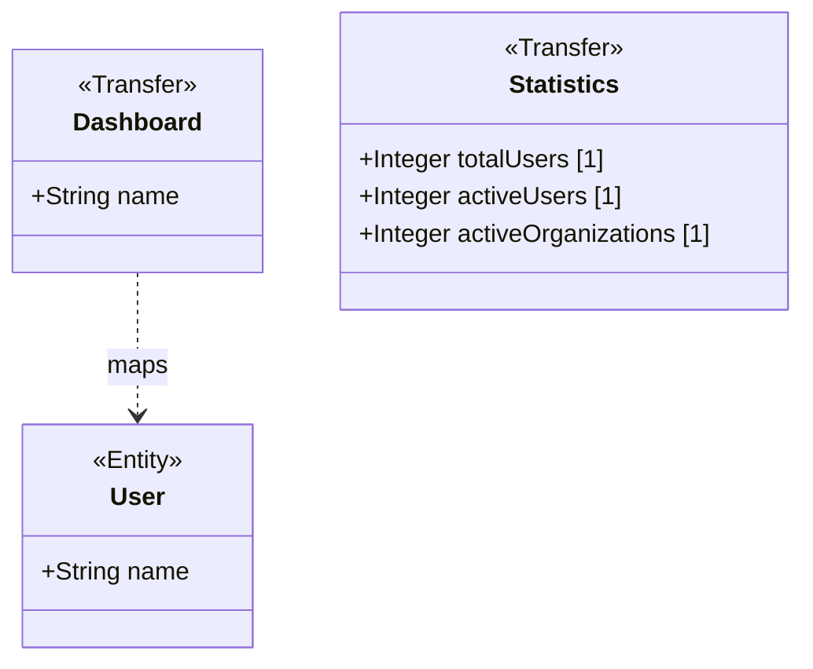

## Model shape

The shape has one entity that the dashboard maps, one transfer object for the dashboard, and one transient transfer object for the statistics.

- **User** is the entity the dashboard maps. It holds a stored `name`.
- **Dashboard** is a transfer object that maps User. It exposes the mapped attributes and carries the dashboard operations. It is the access point an actor opens first.
- **Statistics** is a transfer object with transient count attributes (`totalUsers`, `activeUsers`, `activeOrganizations`). It is not createable, updateable or deleteable. The values are not stored. The attributes are transient (no binding), and an interceptor on the mapped read operations fills them in when the statistics are read ([interceptors guide](../../agent-docs/backend/interceptors.md), Backend-Computed TO Attribute). The Statistics object is unmapped; see the mapped and unmapped transfer object pattern in the [model development guide](../../agent-docs/model/model-development.md).

Statistics are a separate transfer object so the counts do not sit on the mapped entity. A dashboard that needs no counts drops the Statistics object and keeps only the mapped attributes.

Generated UI pages follow from the transfer objects. The Dashboard is the landing view for its actor. The Statistics object is read-only, so its generated form shows counts and no inputs. Keep the Dashboard view, hide the generated edit page for Statistics, and customize the Statistics view when it needs a visual layout.

## Structure diagram

<!-- mermaid:generated fragment=dashboard-transfer-object cli=1.1.0.20261108_202643_d9769d90_develop -->

<!-- /mermaid:generated -->
