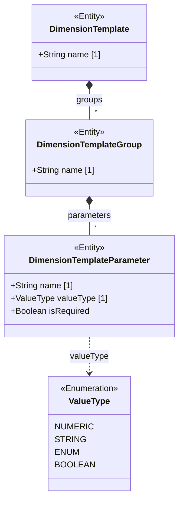

## Model shape

The shape has a template layer that defines the structure and an instance layer that holds values. This entry covers the template layer, and the enumerations it uses.

- **DimensionTemplate** is a non-CRUD entity with a required `name`. It composes **DimensionTemplateGroup** items (0..*).
- **DimensionTemplateGroup** has a required `name` and composes **DimensionTemplateParameter** items (0..*).
- **DimensionTemplateParameter** has a required `name` and a required `valueType` of type **ValueType**. Its `isRequired` flag defaults to false.
- **ValueType** is an enumeration with four members: NUMERIC, STRING, ENUM and BOOLEAN, with ordinals 1 to 4.

The instance layer (group and parameter instances that hold actual values) is outside this shape. It is modelled on the entities that use the template.

Generated UI pages follow from the entities. The template is managed by administrators, so keep the template pages for administrators. Hide the generated create and edit forms for DimensionTemplate, which is not CRUD. Keep the group and parameter pages for editing, and customize the parameter form when the value type changes which inputs are shown.

## Structure diagram

