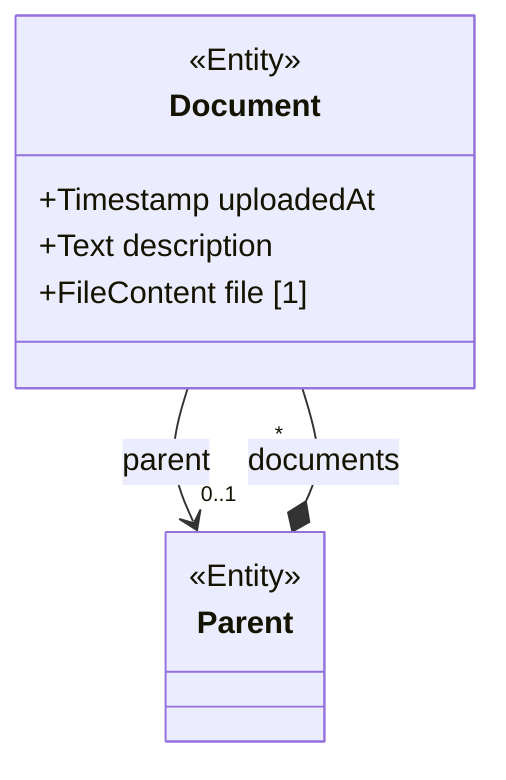

## Model shape

The shape is one non-CRUD document entity that holds a binary file and its metadata, and a transfer object that carries the file to the client.

- **Document** is not createable, updateable or deleteable through the generated interface. It holds a binary `file` (required), an `uploadedAt` timestamp and an optional `description`. It refers to its parent (0..1, association).
- **DocumentInput** (service layer, not drawn in the diagram) is an unmapped transfer object with the `file` field. It is the input of a custom upload operation.
- **DocumentTransfer** (service layer, not drawn in the diagram) is a mapped transfer object for viewing: it exposes the file and the metadata. A binary field mapped on a create-capable transfer gets a generated upload-token operation, so a plain create through the parent needs no custom upload operation.

The parent entity composes or associates the document. The document itself is created through a parent operation, not by the client directly.

Variants that add a `type` or a version attribute, or a URL attribute in place of the binary file, are described in the entry's BLUEPRINT. The URL variant stores a reference to an externally hosted file.

Binary values travel as file-store tokens on the wire, not as bytes in the JSON.

Generated UI pages follow from the entities. The document is non-CRUD, so keep the view and table pages on the parent and hide the generated create and edit forms for Document. Customize the upload action on the parent so it sends a DocumentInput.

## Structure diagram

