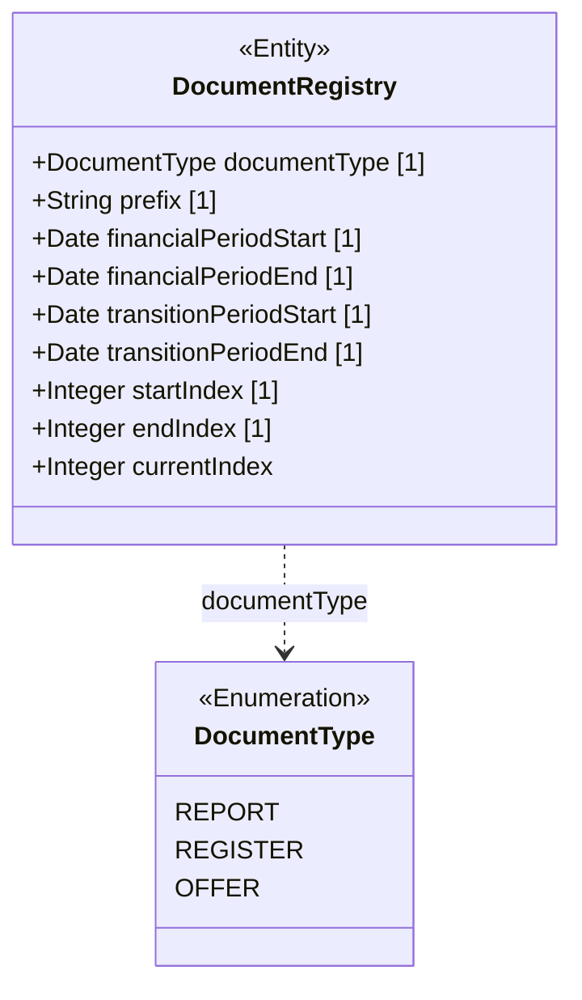

## Model shape

The shape is one non-CRUD entity, `DocumentRegistry`, and one enumeration, `DocumentType`.

- **DocumentType** is an enumeration with one member per document kind. Each member has a fixed ordinal.
- **DocumentRegistry** is not createable, updateable or deleteable through the generated interface. It has a `documentType` of type `DocumentType`, a `prefix` string, a financial period (`financialPeriodStart`, `financialPeriodEnd`), a transition period (`transitionPeriodStart`, `transitionPeriodEnd`), and an index range (`startIndex`, `endIndex`, `currentIndex`). The index attributes are integers. `currentIndex` is advanced by project code.

Each document kind has its own DocumentRegistry rows, so each kind counts on its own. The required attributes are the type, the prefix, the two periods and the range; `currentIndex` is optional until the first number is issued.

The generated DAO offers full create/read/update/delete only for mapped transfer object types, so the project code that advances the counter needs a mapped transfer object of the registry (service layer, not drawn). Expose it to no actor, so clients never reach it.

Generated UI pages follow from the entity. Because the entity is not CRUD, no generated create, edit or delete page is needed. Keep the read-only list for administrators, and hide the generated forms.

## Structure diagram

<!-- mermaid:generated fragment=document-registry-sequence cli=1.1.0.20261108_202643_d9769d90_develop -->

<!-- /mermaid:generated -->
