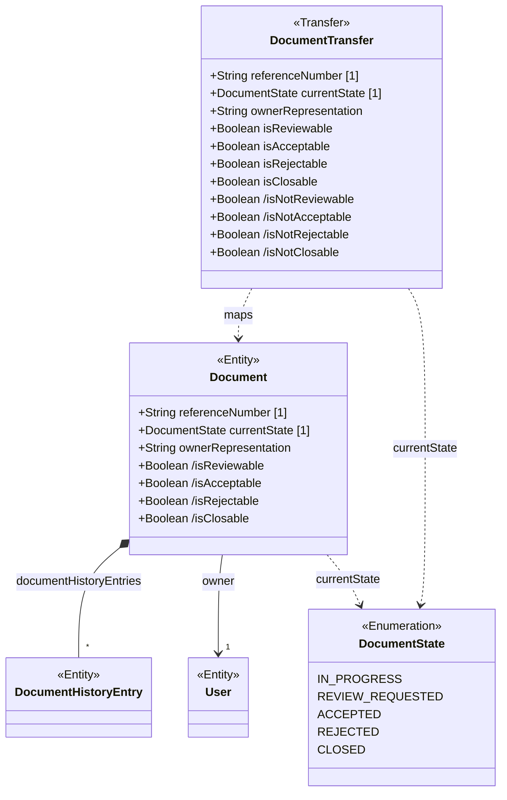

## Model shape

The shape is one document entity with a review cycle, a state enumeration and a transfer object.

- **Document** is a non-CRUD entity. It has a required `referenceNumber`, a `currentState` of type `DocumentState`, an `ownerRepresentation` string, and four guard attributes: `isReviewable`, `isAcceptable`, `isRejectable` and `isClosable`. The guards are derived from the state.
- **DocumentState** is an enumeration with five members: IN_PROGRESS, REVIEW_REQUESTED, ACCEPTED, REJECTED and CLOSED.
- **Document** has four instance operations: `requestReview`, `accept`, `reject` and `close`.
- **Document** refers to one **User** as owner (1..1, association). It holds **DocumentHistoryEntry** items (composition) and **File** items (composition).
- **DocumentTransfer** is the transfer object for the document. It exposes `referenceNumber`, `currentState`, `ownerRepresentation`, the four guards and their four negations (`isNotReviewable`, `isNotAcceptable`, `isNotRejectable`, `isNotClosable`). It maps the four transitions (mapped operations that delegate to the entity's instance operations, whose implementation is custom application code) and offers a static `createDocument` operation.
- **Message** is an unmapped input transfer object with a `message` field, used as the rejection reason.

The transitions are IN_PROGRESS to REVIEW_REQUESTED, REVIEW_REQUESTED to ACCEPTED or REJECTED, and ACCEPTED or REJECTED to CLOSED.

The guards are derived boolean attributes on the entity and are mapped read-only to the transfer object, which the backend computes on read. The negations are derived on the transfer object, so the UI can bind a button's hidden or disabled state directly.

Generated UI pages follow from the entities. The transfer object drives the document form and table, so the buttons read the guard and negation attributes. Keep the generated pages for the document and its history, and customize the action buttons so each one is shown only when its guard is true.

## Structure diagram

<!-- mermaid:generated fragment=document-review-state-machine cli=1.1.0.20261108_202643_d9769d90_develop -->

<!-- /mermaid:generated -->
