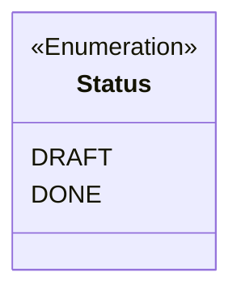

## Model shape

The shape is one enumeration, `Status`, with two members: DRAFT (ordinal 0) and DONE (ordinal 1). The owning entity carries a required `status` attribute of type `Status`, with DRAFT as its default. A named operation on the entity sets the value to DONE when the item is finalized.

The owning entity is not drawn in the diagram, which shows only the enumeration. The default is a model default expression naming the DRAFT literal. The enumeration is not a state machine on its own. The transition is enforced by the owning entity's operation, not by the enumeration.

## Structure diagram

<!-- mermaid:generated fragment=draft-done-status-enum cli=1.1.0.20261108_202643_d9769d90_develop -->

<!-- /mermaid:generated -->
