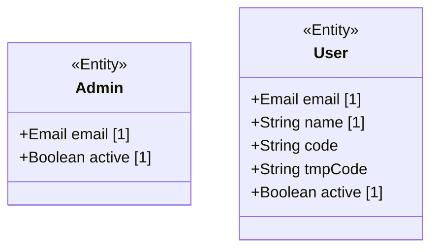

## Model shape

The shape has two entities for the two actors, two unmapped transfer objects for the flow, and one application transfer object that exposes the flow.

- **User** is the end-user account. It is not createable, updateable or deleteable through generated actions. Its attributes are email (required, e-mail type), name (required), active (required, default true), code (the active code) and tmpCode (the pending code). It has a reset operation (instance) that regenerates the active code.
- **Admin** is the administrator account, kept as its own entity. It has email (required) and active (required, default true).
- **RegisterInput** is an unmapped transfer object with email (required) and name (optional). It is the input of the register operation.
- **Credential** is an unmapped transfer object with email (required) and code (required). It is the input of the activate operation.
- **Application** is the end user's entry point. It has two static operations, register and activate, that take RegisterInput and Credential.

The Application is a transfer object, not a persistent entity, so it adds no table. Its operations are the only way an end user reaches the User entity.

Generated UI pages follow from the entities. The generated Form for User should be hidden, because the flow creates users and the admin should not type codes by hand. The View and Table pages stay for the admin dashboard.

## Structure diagram

<!-- mermaid:generated fragment=email-code-guest-authentication cli=1.1.0.20261108_202643_d9769d90_develop -->

<!-- /mermaid:generated -->
