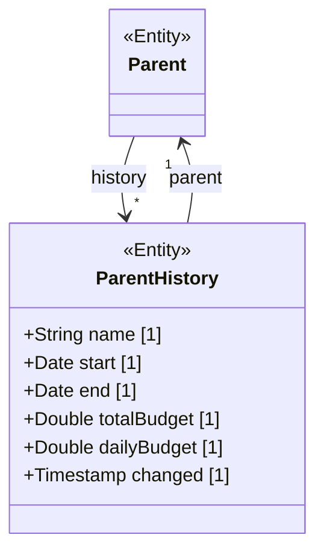

## Model shape

The shape has one parent entity and one history entity. The history entity is not part of the generated CRUD surface.

- **Parent** holds the live values. It has the list `history` (0..*), an association to its history rows.
- **ParentHistory** is the snapshot row. It is not createable, updateable or deleteable through generated actions. It holds copies of the key attributes: name (required string), start and end (required dates), totalBudget and dailyBudget (required doubles), and changed (required timestamp). Its association `parent` is required (1..1).

The model uses `Double` for the amounts, because the shared primitive set in the fixture has no decimal type. A project with a decimal type should use it for money.

## Structure diagram

<!-- mermaid:generated fragment=entity-change-history-snapshot cli=1.1.0.20261108_202643_d9769d90_develop -->

<!-- /mermaid:generated -->
