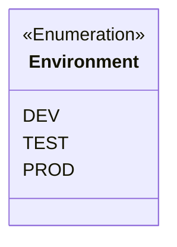

## Model shape

The shape is one enumeration, `Environment`, with three members: DEV (ordinal 1), TEST (ordinal 2) and PROD (ordinal 3). Members persist by ordinal, so they are never renumbered.

A deployment-related entity carries a required attribute of type `Environment`. The entity itself is not part of this shape.

## Structure diagram

<!-- mermaid:generated fragment=environment-enum cli=1.1.0.20261108_202643_d9769d90_develop -->

<!-- /mermaid:generated -->
