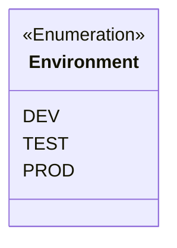

## Model shape

The shape is one enumeration, `Environment`, with three members: DEV (ordinal 1), TEST (ordinal 2) and PROD (ordinal 3). Members persist by ordinal, so they are never renumbered.

Ordinals start at 1 here. Any unique values from 0 to 9999 are valid. In custom Java code a value converts from its ordinal with the generated enum's `getByOrdinal`.

A deployment-related entity carries a required attribute of type `Environment`. The entity itself is not part of this shape.

## Structure diagram

