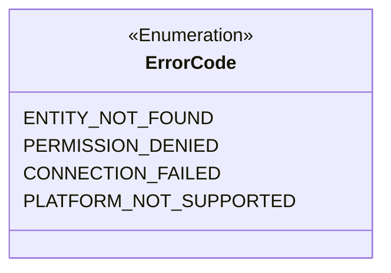

## Model shape

The shape has one enumeration of error codes and one general business error object that carries a code and a message.

- **ErrorCode** is the enumeration of business error codes. One member per error, stored by ordinal. Members follow the pattern of a short upper-case name for the failure, such as entity not found or permission denied.
- **BusinessError** is the general error object. It is not mapped to an entity and has no generated CRUD. Its `code` (typed to ErrorCode) and `message` (text) are required. An operation declares it as its fault, so the generated client knows about it.

The model shows one enumeration and one error object. The variants below use different names and placement, and a project may omit the enumeration altogether.

### Variants seen across projects

- **Modeled enumeration, application-wide.** One enumeration in the shared entities package, with the business error object beside it. Used in an identity project (about twenty codes) and a rental-property project (about eight codes).
- **Modeled enumeration, domain-scoped.** An enumeration for one domain only, such as workflow declaration validation, with one or a few codes that grow over time.
- **Modeled enumeration, actor-scoped.** The enumeration and the error object live in one actor's namespace, so the codes belong to that actor's API. Used in a quiz project with five codes.
- **Plain string codes.** No enumeration. The business error object has a string `code` and a `message`, and the codes are constants in application code. Used in a platform project with several operations.
- **Enumeration with a numeric gap.** One validation code is placed at a high ordinal, far from the domain codes. Keep the domain codes contiguous and put validation codes in their own block.

The name of the code field varies (`code` or `errorCode`), and so does the error object's name (`BusinessError` or `Error`). Pick one and keep it across the application.

## Structure diagram

<!-- mermaid:generated fragment=error-code-enum cli=1.1.0.20261108_202643_d9769d90_develop -->

<!-- /mermaid:generated -->
