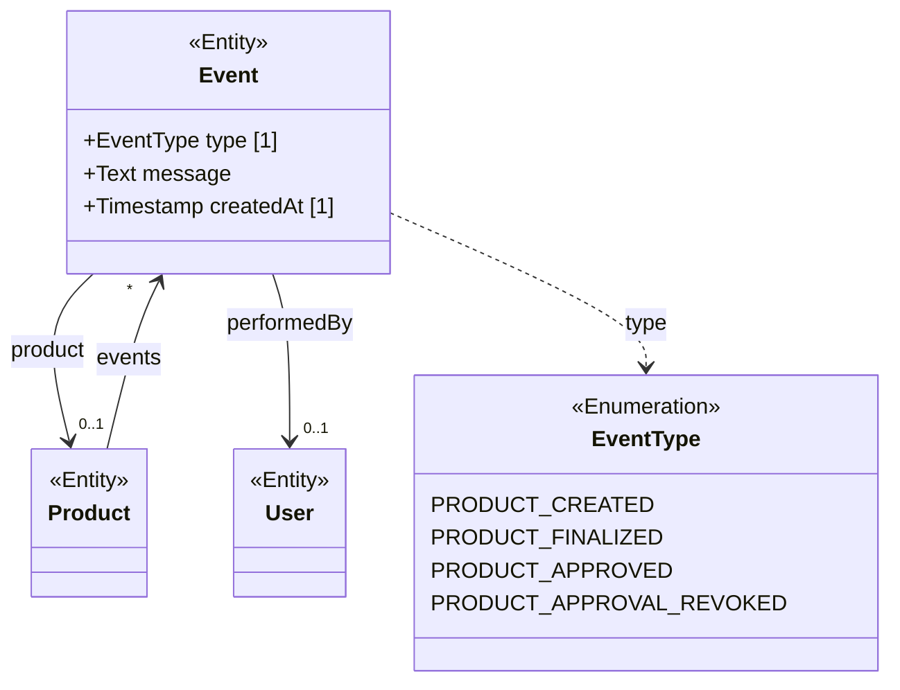

## Model shape

The shape has one non-CRUD entity, one enumeration, and two referenced entities (the affected entity and the acting user).

- **Event** is the log row. It is not createable, updateable or deleteable through generated actions. Its attributes are type (required, enumeration), message (text) and createdAt (required timestamp).
- **EventType** is the enumeration of recorded events. Each domain event kind has one value. Values are stored as ordinals.
- **Product** is the affected entity in the example. It has the inverse relation `events`, a list of its events (0..*).
- **User** is the acting user. Each event has at most one user (0..1).

Both associations are optional (0..1) and of kind ASSOCIATION, so deleting the target does not remove the event.

## Structure diagram

