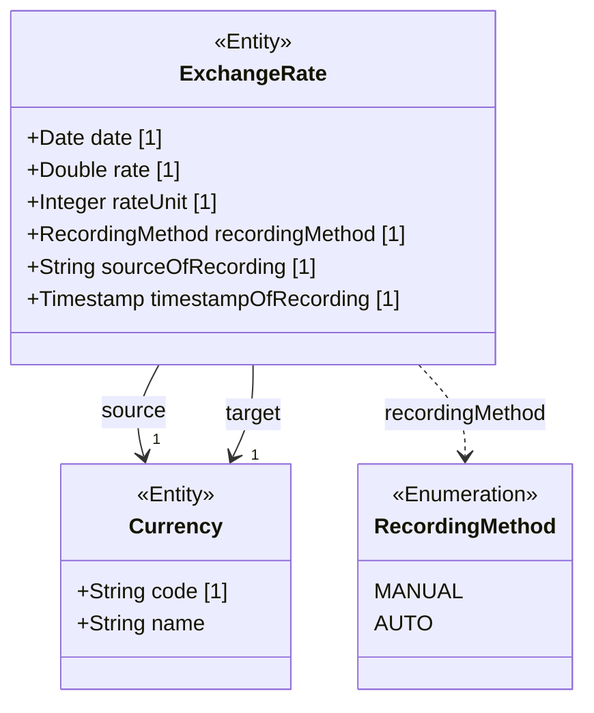

## Model shape

The shape has one non-CRUD rate entity, one reference entity, and one enumeration.

- **ExchangeRate** is the rate row. It is not createable, updateable or deleteable through generated actions. Its attributes are date (required), rate (required), rateUnit (required, default 1), recordingMethod (required, enumeration), sourceOfRecording (required text) and timestampOfRecording (required, the time it was recorded). Its two associations, source and target, each point to one Currency and are required (1..1).
- **Currency** is the reference table. It is not createable, updateable or deleteable through generated actions. It has a code (required, the identifier) and a name.
- **RecordingMethod** is the enumeration of how a rate was obtained: MANUAL or AUTO. Values are stored as ordinals.

The model uses `Double` for the rate, because the shared primitive set in the fixture has no decimal type. A project with a decimal type should use it for the rate.

The timestamp default (the time of recording) is not set in this scratch model: the CLI rejected the default expression forms tried here. The entity should set it when the row is written.

## Structure diagram

