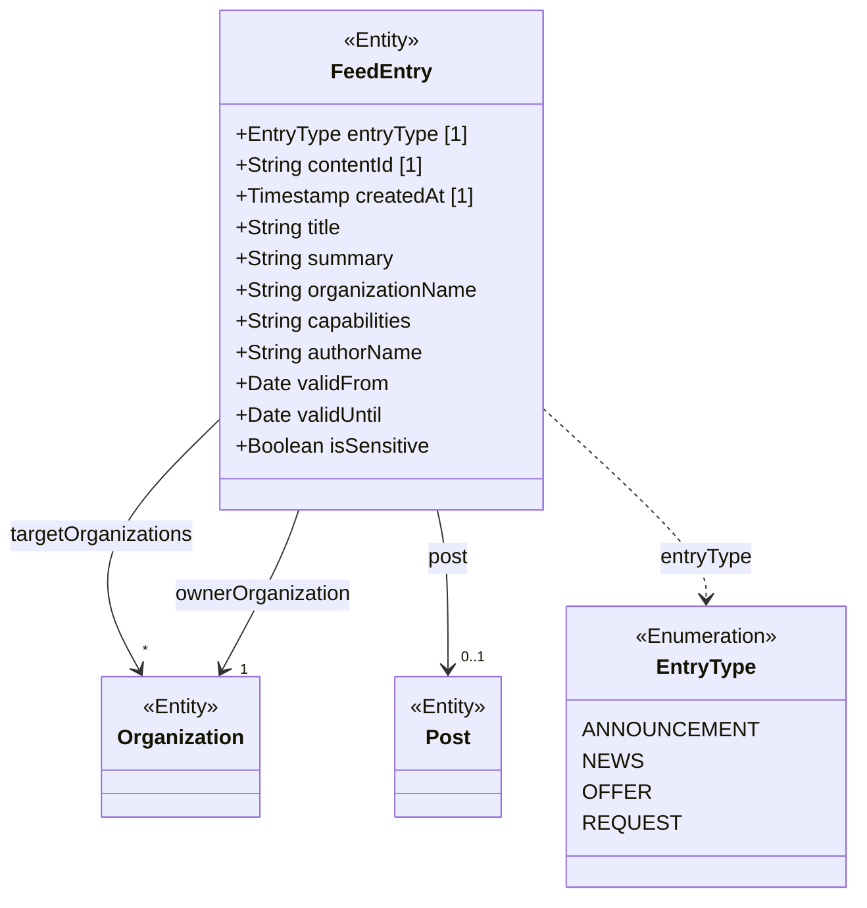

## Model shape

The shape has one non-CRUD feed entity, one enumeration, and two referenced entities (the source post and the organization).

- **FeedEntry** is the feed row. It is not createable, updateable or deleteable through generated actions. Its required attributes are entryType (enumeration), contentId (string) and createdAt (timestamp). Its display attributes are title, summary, organizationName, capabilities, authorName, validFrom, validUntil and isSensitive.
- **EntryType** is the enumeration of content kinds shown in the feed (announcement, news, offer, request). Values are stored as ordinals.
- **Post** is the source item. A feed row has at most one source post (0..1).
- **Organization** is the owner and the target. A feed row has exactly one owning organization (1..1) and any number of target organizations (0..*).

All associations are ASSOCIATION kind, so deleting a source or an organization does not remove the feed row unless the backend does.

## Structure diagram

<!-- mermaid:generated fragment=feed-entry-denormalization cli=1.1.0.20261108_202643_d9769d90_develop -->

<!-- /mermaid:generated -->
