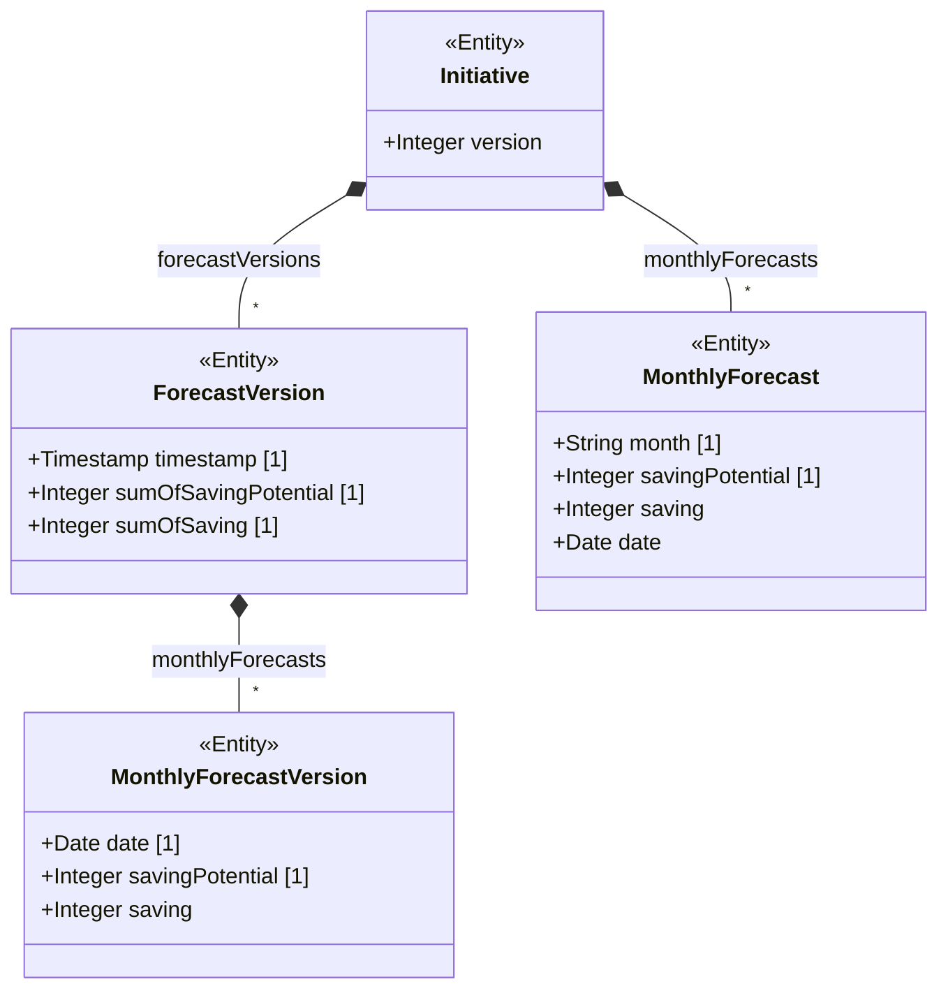

## Examples

### itracker
- **Initiative entity** (`itracker::entities::Initiative`): the parent entity for cost-saving initiatives
  - Relations: monthlyForecasts (0..* COMPOSITION to MonthlyForecast), forecastVersions (0..* COMPOSITION to ForecastVersion)
  - Operations: archiveForecast (INSTANCE) -- snapshots the current monthly forecasts into a new ForecastVersion
  - Also has: version attribute (integer, tracks a version counter incremented on each archive)
- **MonthlyForecast entity** (`itracker::entities::MonthlyForecast`): non-CRUD
  - Attributes: month (req), savingPotential (req), saving, date
  - No relations, no operations
  - Represents a single month's forecast within the current (active) forecast plan
- **ForecastVersion entity** (`itracker::entities::ForecastVersion`): non-CRUD
  - Attributes: timestamp (req), sumOfSavingPotential (req), sumOfSaving (req)
  - Relations: monthlyForecasts (0..* COMPOSITION to MonthlyForecastVersion)
  - Each version captures the aggregate totals and a complete copy of the monthly breakdown at the time of archiving
- **MonthlyForecastVersion entity** (`itracker::entities::MonthlyForecastVersion`): non-CRUD
  - Attributes: date (req), savingPotential (req), saving
  - No relations, no operations
  - Immutable copy of MonthlyForecast data frozen within a ForecastVersion
- **Transfer objects**:
  - `itracker::actors::user::ForecastVersion` (mapped): exposes timestamp, sumOfSavingPotential, sumOfSaving, monthlyForecasts (0..* AGGREGATION)
  - `itracker::actors::user::MonthlyForecast` (mapped): exposes month, savingPotential, saving, date
  - `itracker::actors::user::MonthlyForecastVersion` (mapped): exposes date, savingPotential, saving
  - `itracker::actors::user::Initiative` (mapped): exposes forecastVersions (0..* AGGREGATION) and monthlyForecasts (0..* AGGREGATION), plus archiveForecast (MAPPED) operation

## Structure diagram

<!-- mermaid:generated fragment=forecast-versioning-snapshot cli=1.1.0.20261108_202643_d9769d90_develop -->

<!-- /mermaid:generated -->
