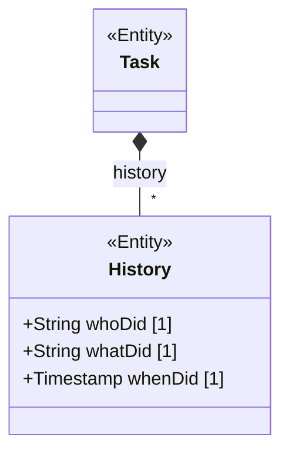

## Examples

### rackinspect
- **Entity**: `rackinspect::entities::History` (non-CRUD)
  - Attributes: whoDid (req), whatDid (req), whenDid (req)
  - No relations on the entity itself
- Composed by Task entity via `history` (0..* COMPOSITION)
- Task entity also has: created (default: now()), modified (default: now()), registryNumber; relations: documents (0..* COMPOSITION to Document), lastDocument (0..1 ASSOC), assignedTo (1..1 ASSOC to User)
- Provides a simple chronological audit log per task without structured enum-based action types

## Structure diagram

<!-- mermaid:generated fragment=history-audit-trail-entity cli=1.1.0.20261108_202643_d9769d90_develop -->

<!-- /mermaid:generated -->
