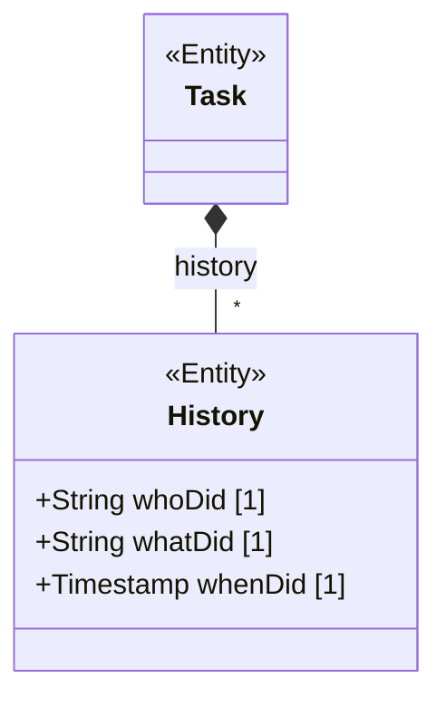

## Model shape

`History` is an entity whose create, update and delete flags are off, so no generated page or endpoint can write it. It has three required attributes: `whoDid` (string), `whatDid` (string) and `whenDid` (timestamp). It has no relations of its own.

A parent entity (`Task` in the reference project) composes History rows through `history`, a 0..* composition relation, so the rows are deleted with the parent. Because the relation is a composition, a row is created through the parent's relation, not on its own.

The timestamp has no model default in this shape: backend code sets it when it writes the row. A model default expression such as the current timestamp is a possible variation; the platform evaluates it in the platform time zone, not the JVM zone (see the platform time-zone notes in the backend agent-docs).

UI: the generated Table of History rows on the parent's View page is kept read-only. The create, edit and delete actions do not appear because the flags are off.

## Structure diagram

<!-- mermaid:generated fragment=history-audit-trail-entity cli=1.1.0.20261108_202643_d9769d90_develop -->

<!-- /mermaid:generated -->
