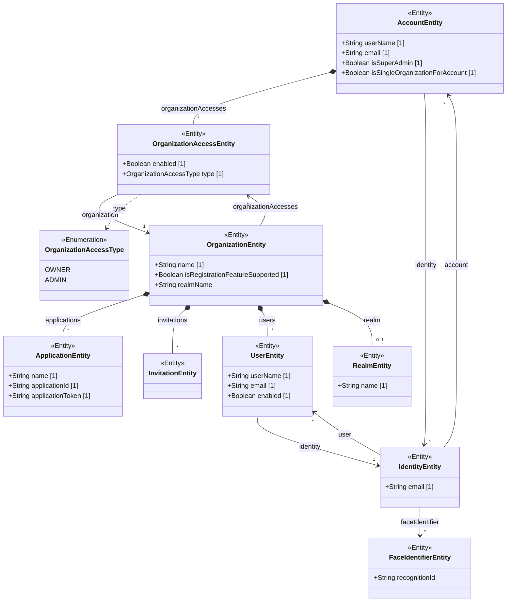

## Model shape

All cluster entities are non-CRUD: they are written by custom operations and services, not by generated create pages.

- `IdentityEntity`: required `email`; associations (0..*) to accounts, organization-scoped users and face identifiers. The identity is the hub for one person.
- `AccountEntity`: required `userName` and `email`, `isSuperAdmin` (default false) and `isSingleOrganizationForAccount` (default true); association (1..1) to its identity; composition (0..*) of `OrganizationAccessEntity`. Derived negations of the two flags (`isNotSuperAdmin` and so on) are guard attributes for the UI; derived attributes are computed on read, never stored.
- `UserEntity` (organization-scoped user): required `userName`, `email` and `enabled` (default true); association (1..1) to its identity; derived relations to accounts and to its organization, plus a derived `notEnabled` guard.
- `OrganizationEntity`: required `name`, `isRegistrationFeatureSupported` (default false), optional `realmName`; compositions of applications (0..*), invitations (0..*), users (0..*) and one optional `RealmEntity`; association (0..*) to the accesses that point at it.
- `OrganizationAccessEntity`: required `enabled` (default true) and `type`, an `OrganizationAccessType` enumeration with OWNER (1) and ADMIN (2); association (1..1) to the organization; derived `account`, `userName` and `organizationName`.

Instance operations in one project, such as `createOrganization`, `inviteUser`, `changeAccessToAdmin` and `enableAccess`, are exposed on transfer objects mapped to these entities. They are custom operations (see the backend notes).

**Transfer objects.** `Account`, `Profile` and the principal transfer object `AccountPrincipal` map to `AccountEntity`; `Organization` and `DashboardOrganization` map to `OrganizationEntity`; `OrganizationAccount` maps to `OrganizationAccessEntity` and flattens the type into `isAdministrator` and `isOwner`; `PartnerDashboard` is an unmapped access point with static operations. The principal's derived flags (`isOrganizationSelected`, `alwaysTrue`, `alwaysFalse`) hide or show UI parts; they are visibility hints only and do not replace access rules.

**Pages.** Generated View and Table pages of `Organization` and `OrganizationAccount` are kept; the dashboard page is custom code (see the frontend notes). The diagram below omits transfer objects and derived members.

## Structure diagram

<!-- mermaid:generated fragment=identity-account-organization-cluster cli=1.1.0.20261108_202643_d9769d90_develop -->

<!-- /mermaid:generated -->
