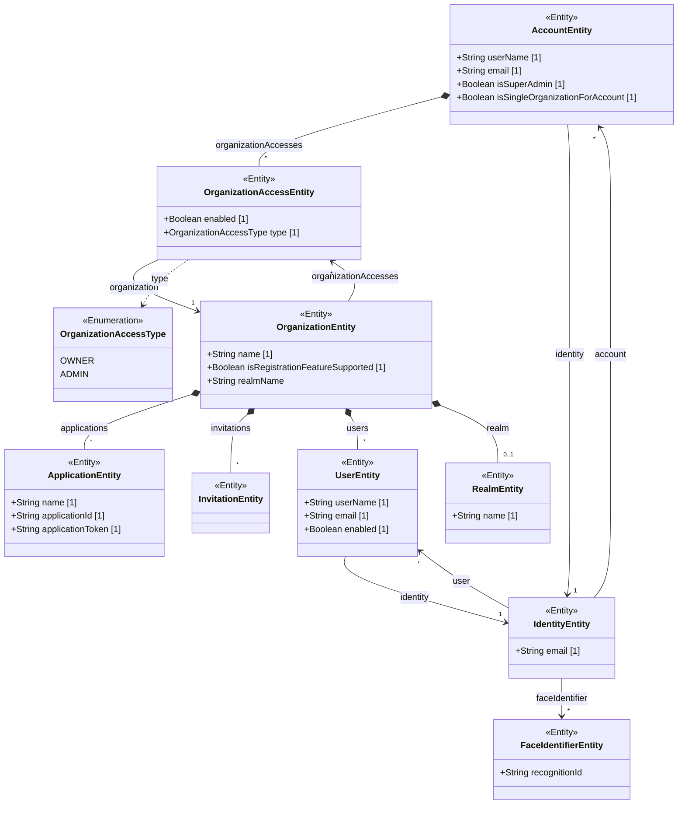

## Examples

### ubives
**Entity cluster:**
- **IdentityEntity**: `Ubives::entities::IdentityEntity` (non-CRUD)
  - Attributes: email (req)
  - Relations: faceIdentifier (0..* ASSOC to FaceIdentifierEntity), user (0..* ASSOC to UserEntity), account (0..* ASSOC to AccountEntity)
  - Central identity hub: one person has one identity, which can link to multiple accounts and multiple organization-scoped users
- **AccountEntity**: `Ubives::entities::AccountEntity` (non-CRUD)
  - Attributes: userName (req), email (req), isSuperAdmin (req, default: false), isNotSuperAdmin (derived), isSingleOrganizationForAccount (req, default: true), isNotSingleOrganizationForAccount (derived)
  - Relations: identity (1..1 ASSOC to IdentityEntity), organizationAccesses (0..* COMPOSITION to OrganizationAccessEntity)
  - Operations: createOrganization (INSTANCE)
  - Guard attributes (isNotSuperAdmin, isNotSingleOrganizationForAccount) control UI visibility
- **UserEntity**: `Ubives::entities::UserEntity` (non-CRUD)
  - Attributes: userName (req), email (req), enabled (req, default: true), notEnabled (derived)
  - Relations: identity (1..1 ASSOC), accounts (0..* DERIVED), organization (0..1 DERIVED)
  - Operations: enableUser (INSTANCE), disableUser (INSTANCE)
- **OrganizationEntity**: `Ubives::entities::OrganizationEntity` (non-CRUD)
  - Attributes: name (req), isRegistrationFeatureSupported (req, default: false), isRegistrationFeatureNotSupported (derived), realmName (optional)
  - Relations: applications (0..* COMPOSITION), invitations (0..* COMPOSITION), realm (0..1 COMPOSITION to RealmEntity), users (0..* COMPOSITION), organizationAccesses (0..* ASSOC)
  - Operations: createApplication, inviteAccount, inviteUser, enableOrganizationRegistration, disableOrganizationRegistration, leaveOrganization, deleteOrganization (all INSTANCE)
- **OrganizationAccessEntity**: `Ubives::entities::OrganizationAccessEntity` (non-CRUD)
  - Attributes: type (req, OrganizationAccessType enum), enabled (req, default: true), userName (derived), organizationName (derived)
  - Relations: account (0..1 DERIVED), organization (1..1 ASSOC)
  - Operations: cancelAccess, changeAccessToAdmin, changeAccessToOwner, disableAccess, enableAccess (all INSTANCE)
- **OrganizationAccessType enum**: `Ubives::entities::OrganizationAccessType` -- OWNER(1), ADMIN(2)

**Transfer objects:**
- `Account` TO -- mapped to AccountEntity; operations: createOrganization
- `AccountPrincipal` TO -- mapped to AccountEntity with guard flags: isOrganizationSelected, isNotOrganizationSelected, alwaysTrue, alwaysFalse
- `Profile` TO -- mapped to AccountEntity; operations: createOrganization, leaveOrganization
- `Organization` TO -- mapped to OrganizationEntity with users, applications, invitations, organizationAccounts relations; operations: createApplication, inviteAccount, inviteUser, enable/disableOrganizationRegistration, leaveOrganization
- `DashboardOrganization` TO -- simplified Organization view for dashboard; all operations mapped
- `OrganizationAccount` TO -- mapped to OrganizationAccessEntity; attributes: type, email, userName, isAdministrator, isOwner, enabled; operations: cancelAccess, changeAccessToAdmin, changeAccessToOwner, disableAccess, enableAccess
- `PartnerDashboard` TO -- empty access point TO with static operations: createOrganization, createApplication, inviteAccount, inviteUser, etc.

## Structure diagram

<!-- mermaid:generated fragment=identity-account-organization-cluster cli=1.1.0.20261108_202643_d9769d90_develop -->

<!-- /mermaid:generated -->
