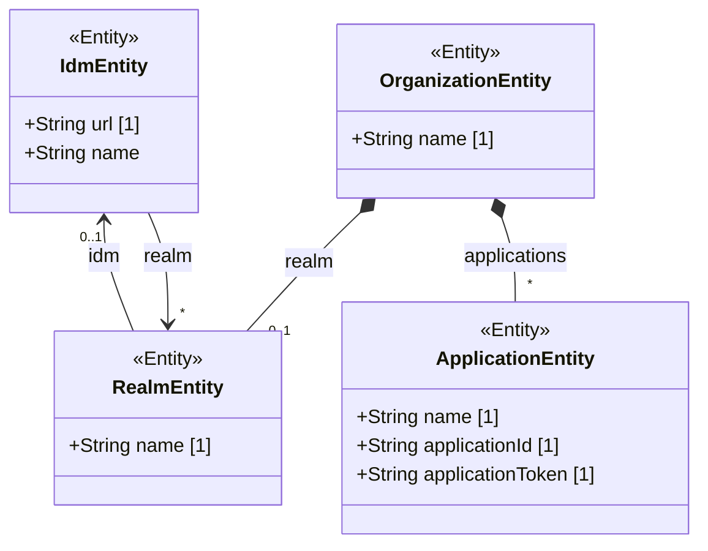

## Examples

### ubives
- **IdmEntity**: `Ubives::entities::IdmEntity` (non-CRUD)
  - Attributes: url (req), name (optional)
  - Relations: realm (0..* ASSOC to RealmEntity)
  - Represents a Keycloak server instance; initialized by Initializer.initDefaultIdm
- **RealmEntity**: `Ubives::entities::RealmEntity` (non-CRUD)
  - Attributes: name (req)
  - Relations: idm (0..1 ASSOC to IdmEntity)
  - Composed by OrganizationEntity via realm (0..1 COMPOSITION); each org gets its own realm
- **ApplicationEntity**: `Ubives::entities::ApplicationEntity` (non-CRUD)
  - Attributes: name (req), applicationId (req), applicationToken (req)
  - Relations: organization (0..1 DERIVED back to OrganizationEntity)
  - Operations: deleteApplication (INSTANCE)
  - Represents a Keycloak client registered within an organization's realm
- **FaceIdentifierEntity**: `Ubives::entities::FaceIdentifierEntity` (non-CRUD)
  - Attributes: recognitionId (optional)
  - Linked from IdentityEntity (0..* ASSOC) for biometric authentication support
- **Transfer objects:**
  - `Idm` TO -- url, name; relation: realm (0..* ASSOC)
  - `Realm` TO -- name; relation: idm (0..1 ASSOC)
  - `Application` TO -- name, applicationId, applicationToken; operations: newApplication (STATIC), deleteApplication (MAPPED)
  - `FaceIdentifier` TO -- recognitionId
- Organization.realmName derived attribute provides quick display of the associated realm's name

## Structure diagram

<!-- mermaid:generated fragment=idm-realm-keycloak-integration cli=1.1.0.20261108_202643_d9769d90_develop -->

<!-- /mermaid:generated -->
