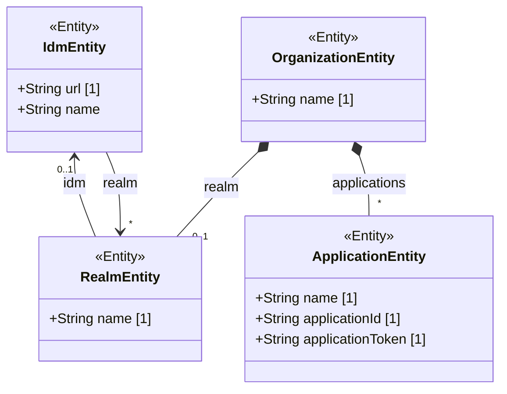

## Model shape

The model-side shape is small and holds the identity server as data. Entities are non-CRUD and are written by custom operations or an initializer.

- `IdmEntity`: required `url`, optional `name`; association (0..*) to `RealmEntity`. It stands for one Keycloak server. The reference project seeds it with an initializer operation.
- `RealmEntity`: required `name`; optional association (0..1) back to its `IdmEntity`. An `OrganizationEntity` composes at most one realm (0..1 composition), so a realm lives and dies with its organization.
- `ApplicationEntity`: required `name`, `applicationId` (client identifier) and `applicationToken` (client secret); composed by the organization (0..*), with a derived back relation to it. One instance operation deletes the application. It stands for a client registered in the organization's realm.
- `FaceIdentifierEntity`: optional `recognitionId`, linked from the identity entity; it supports biometric sign-in and is outside the realm shape.

Transfer objects in the reference project: `Idm` and `Realm` (mirror the entities), `Application` (adds a static `newApplication` operation and a mapped `deleteApplication`) and `FaceIdentifier`. The organization shows its realm's name through a derived `realmName` (the diagram omits it, and omits the face identifier).

The realm and client definitions on the identity server are not modeled here. They are platform configuration: the model-to-Keycloak transformation creates a realm for each distinct realm annotation on actor types and a client for each such actor (see the deployment agent-docs). This shape covers the per-organization realms and clients that the application creates at run time, which are not generated from actor annotations.

Pages: the `Idm` and `Realm` tables are administrator-only. The `Application` table is shown on the organization page without the token column.

## Structure diagram

<!-- mermaid:generated fragment=idm-realm-keycloak-integration cli=1.1.0.20261108_202643_d9769d90_develop -->

<!-- /mermaid:generated -->
