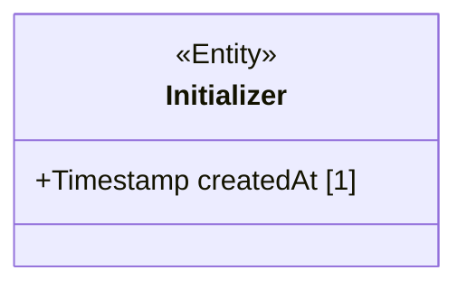

## Model shape

The shape has one non-CRUD entity with one marker attribute and one static operation.

- **Initializer** is the entity that holds the init operation. It is not createable, updateable or deleteable through generated actions, so it stays a single well-known element. Its attribute is `createdAt`, a required timestamp, written when the seed completes.
- **init** is a static, stateful operation flagged as an initializer. It takes no input, as the platform requires of an initializer operation. Its body is custom code in the backend, so the model declares the operation and the backend implements it. In the OSGi runtime the platform runs an initializer on its own when the model component activates, on every start ([platform behavior reference](../../agent-docs/backend/platform-behavior-reference.md#initializer-operations)); in one project a startup or deployment routine calls it as well.

The init operation seeds reference data such as codes, default configuration and an admin account. Generated pages do not expose the Initializer to end users, because it has no create or edit action. Hide the Initializer from navigation or leave it for administrators only.

## Structure diagram

