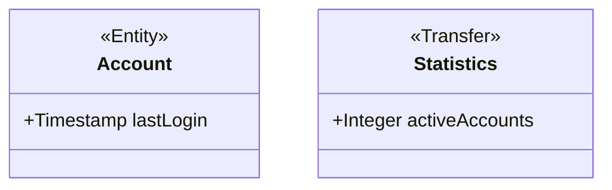

## Model shape

The shape has one writable entity and one transfer object for the statistics.

- **Account** is the entity the statistics count. It is createable, updateable and deleteable, and holds a stored `lastLogin` timestamp that the date filter reads.
- **Statistics** is a transfer object that carries transient count attributes with no binding, such as `activeAccounts`. It is not createable, updateable or deleteable. Its values are not stored; the interceptor fills them in on each read.

The counts exist only on the built-in list and refresh operations the interceptor is attached to. Generated pages can show the Statistics transfer object as a read-only view, but the numbers appear only through those built-in operations.

## Structure diagram

