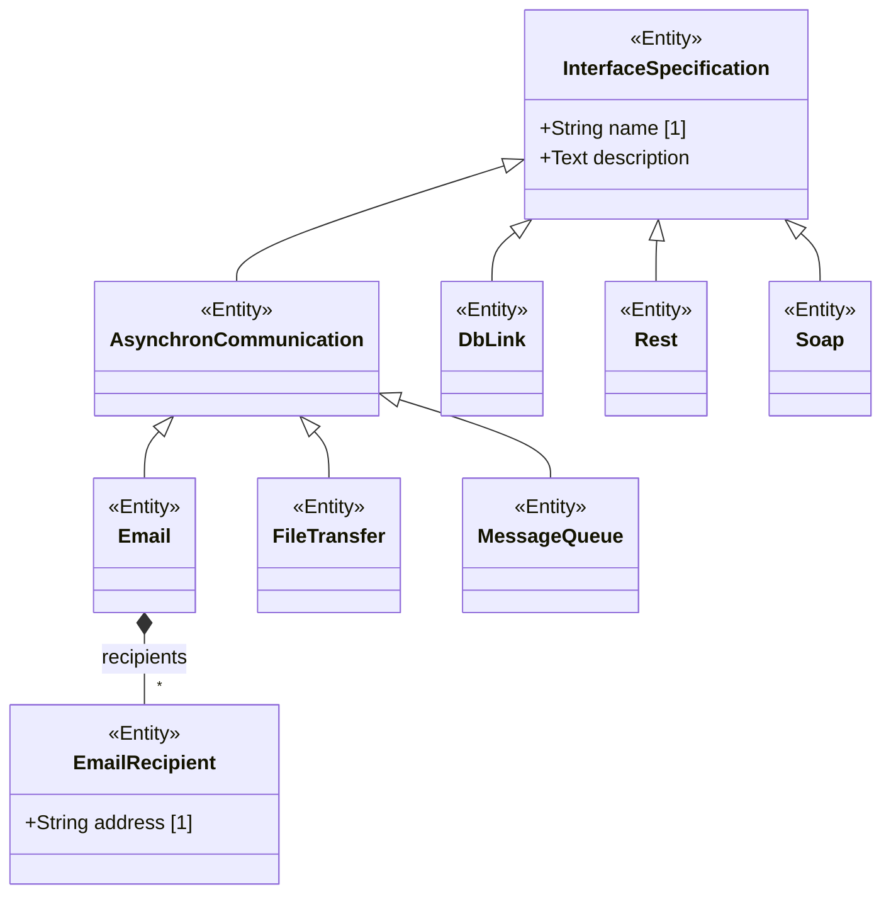

## Model shape

The shape is a generalization hierarchy with one base entity and six concrete subtypes. The base entity carries the attributes every interface shares. Each subtype adds only what its protocol needs.

- **InterfaceSpecification** is the base entity. It is not createable, updateable or deleteable. It holds a required identifier name, a description, a link to the specification, a binary specification document, and a required direction of transmission.
- **Synchronous subtypes** generalize the base directly: **Rest**, **Soap** and **DbLink**. Rest adds a link to an OpenAPI specification and an OpenAPI document. Soap adds a WSDL document and a link to the WSDL specification. DbLink adds nothing.
- **AsynchronCommunication** is an intermediate subtype that groups the asynchronous protocols. It adds no attributes of its own.
- **Asynchronous subtypes** generalize AsynchronCommunication: **Email**, **FileTransfer** and **MessageQueue**. Email composes its recipients, and each recipient is an **EmailRecipient** with a required address. FileTransfer adds a transfer method and a character encoding, both enumerations, and an extension. MessageQueue adds nothing.

The hierarchy is a polymorphic view. A read-only transfer object over the base entity lists every specification, and each concrete subtype gets its own transfer object for create and update. Transfer objects cannot inherit from each other, so none of them is part of a hierarchy; only the entities are. Generated pages follow from the entities: a read-only list for the base, and a view, form and table for each subtype.

## Structure diagram

<!-- mermaid:generated fragment=interface-specification-generalization-hierarchy cli=1.1.0.20261108_202643_d9769d90_develop -->

<!-- /mermaid:generated -->
