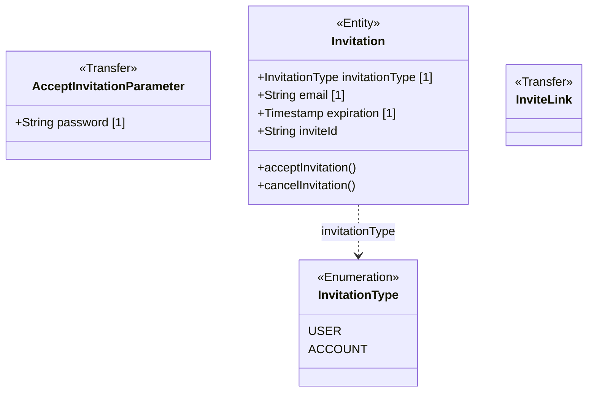

## Model shape

The shape has one non-CRUD entity, one enumeration and two transfer objects that expose the invitation.

- **Invitation** is the entity. It is not createable, updateable or deleteable through generated actions. Its attributes are invitationType (required, enumeration), email (required), expiration (required timestamp) and inviteId (the key carried in the link). It has two custom operations: accept and cancel.
- **InvitationType** is the enumeration: USER (an invitation for a new user) and ACCOUNT (an invitation for an existing account to join).
- **InviteLink** is the transfer object the invitee reaches through the link. It maps the invitation's email and exposes accept and cancel. It is shown on an anonymous page.
- **AcceptInvitationParameter** is the input of accept. It carries the password and its confirmation as transient values. It is not stored.

Generated UI pages follow from the transfer objects: a view page for the link and a form for the accept parameters. The Invitation entity itself stays non-CRUD, so no create or edit page is generated for it. Hide the anonymous page from authenticated navigation.

## Structure diagram

<!-- mermaid:generated fragment=invitation-with-key-based-acceptance cli=1.1.0.20261108_202643_d9769d90_develop -->

<!-- /mermaid:generated -->
