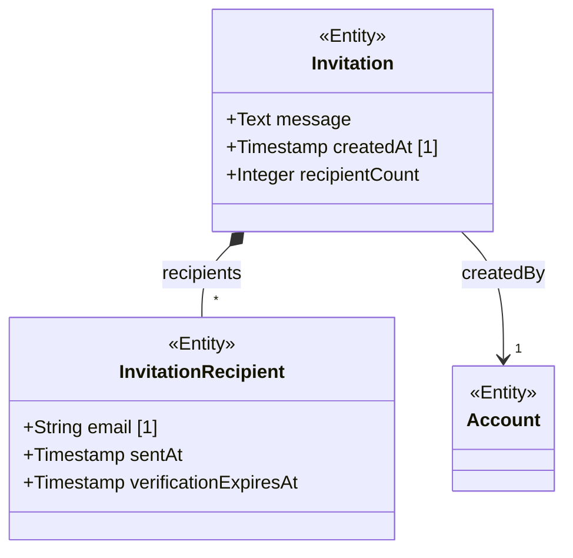

## Model shape

The shape has one batch entity and one entity per recipient.

- **Invitation** is the batch. It is not createable, updateable or deleteable through generated actions. Its attributes are an optional message (text), a required creation timestamp, and an optional recipient count. Its one required association is createdBy, an Account (exactly one). It composes zero or more recipients.
- **InvitationRecipient** is one invited address. It is non-CRUD. Its attributes are a required email, an optional sent timestamp and an optional verification expiry timestamp. Each recipient belongs to one invitation.

The composition means the recipients are owned by the invitation and removed with it. The association to the creator is kept for navigation. Generated pages follow from the entities: a read-only view of the invitation with its recipients. Creation happens through a custom operation, so no create form is generated for the invitation.

## Structure diagram

<!-- mermaid:generated fragment=invitation-with-recipients cli=1.1.0.20261108_202643_d9769d90_develop -->

<!-- /mermaid:generated -->
