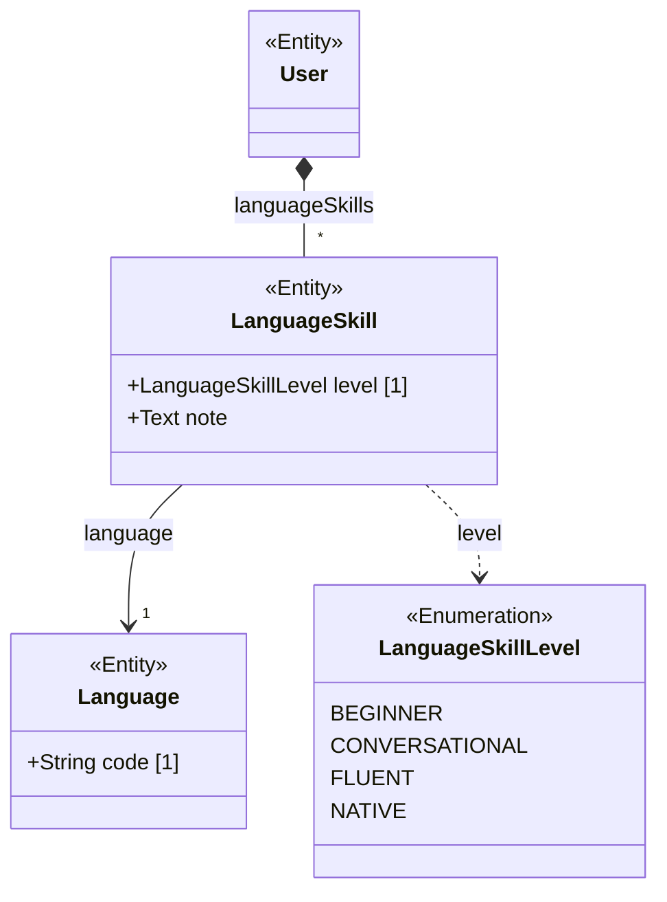

## Model shape

The shape has one enumeration, one reference entity and one entity that links a user to a language.

- **LanguageSkillLevel** is the enumeration. It has four members in order: BEGINNER (ordinal 1), CONVERSATIONAL (2), FLUENT (3) and NATIVE (4).
- **Language** is a reference record with one required identifier, code. It has no operations.
- **LanguageSkill** is the link. It is non-CRUD. Its attributes are level (required, LanguageSkillLevel) and note (text, optional). It has one required association to a Language.
- **User** composes zero or more LanguageSkill entities, so skills are removed with their user.

Generated UI pages follow from the entities: a view and table for the language reference, and the skill is shown inside the user's view. The LanguageSkill entity is non-CRUD, so it has no direct create or edit page. Skills are written by a custom operation or through the owning user.

## Structure diagram

<!-- mermaid:generated fragment=language-proficiency-enum cli=1.1.0.20261108_202643_d9769d90_develop -->

<!-- /mermaid:generated -->
