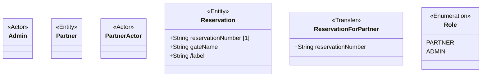

## Model shape

The shape has a shared entity package with a Reservation entity, a Partner entity and a Role enumeration (PARTNER, ADMIN). Each actor reads the shared entities through its own transfer objects, so the admin and the partner see different fields of the same data.

- **Reservation** is the shared entity. Its identifier is `reservationNumber` (required). `gateName` is a stored text field. `label` is a DERIVED value computed from the identifier.
- **Partner** is the entity that the partner actor works for. The diagram shows it without stored attributes.
- **Role** is an enumeration with PARTNER and ADMIN. It is stored on the user, and each role maps to its own transfer objects.
- **ReservationForPartner** is the partner projection of Reservation. It is a transfer object over the same entity with its own field set. Its fields are TRANSIENT, MAPPED or DERIVED, so the partner sees display values and no internal stored fields.
- **Actors**: the admin actor is managed and non-anonymous and reads the full entity. The partner actor is anonymous and uses the partner projection.

Generated UI pages follow from each transfer object: a list and view page per projection. The restricted projection gets read-only pages; the admin projection gets the full set.

Derived and mapped fields in a projection do not add a stored column. They are computed on read.

## Structure diagram

<!-- mermaid:generated fragment=multi-actor-role-based-projections cli=1.1.0.20261108_202643_d9769d90_develop -->

<!-- /mermaid:generated -->
