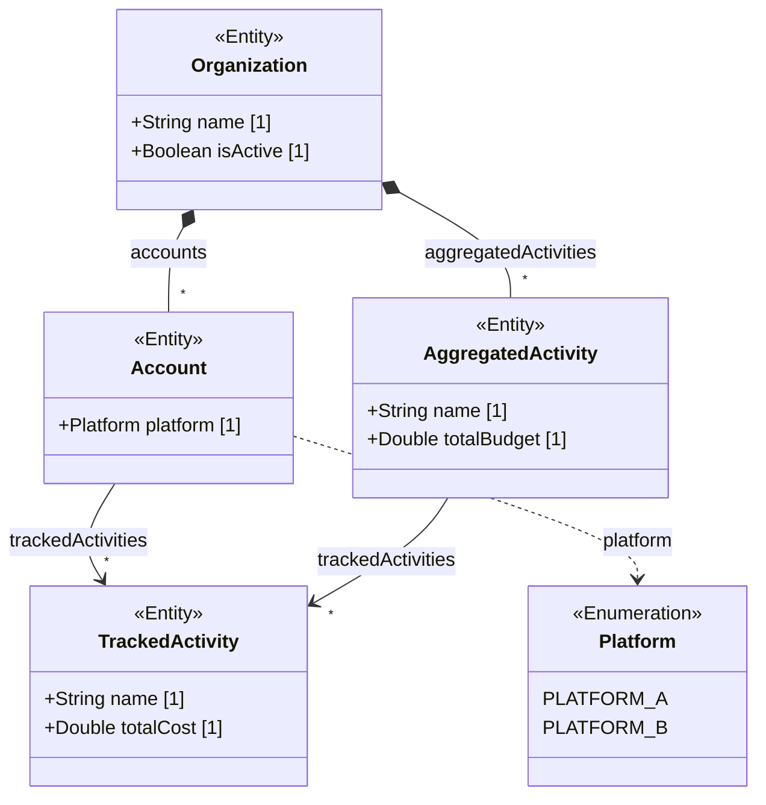

## Model shape

The shape is a small cluster. An Organization owns its platform accounts and its groups. Each account belongs to one external platform, given by an enumeration. Tracked activities are linked to the account they were found on, and a group collects tracked activities across accounts.

- **Organization** has a required name identifier and a required isActive flag that defaults to true. It owns Account (0..*, composition) and AggregatedActivity (0..*, composition).
- **Account** has a required platform, an enumeration with one value per supported external platform (PLATFORM_A and PLATFORM_B in the fragment). It links to TrackedActivity through a 0..* association, so an activity can be read from its account without owning it.
- **AggregatedActivity** has a required name identifier and a required totalBudget. It groups tracked activities through a 0..* association, so an activity can sit in a group without being owned by it.
- **TrackedActivity** has a required name identifier and a required totalCost.

The fragment shows the core of the cluster only. Cost history, fetched-data snapshots, credentials and discovered-but-untracked activities are real parts of such a system, but they are left out here. Model them as further owned children where they are needed.

Generated UI pages follow from the entities: View, Form and Table pages for Organization, Account and AggregatedActivity. Account's Form should not expose the platform credential, which belongs to a separate, protected entity.

## Structure diagram

<!-- mermaid:generated fragment=multi-platform-external-account-cluster cli=1.1.0.20261108_202643_d9769d90_develop -->

<!-- /mermaid:generated -->
