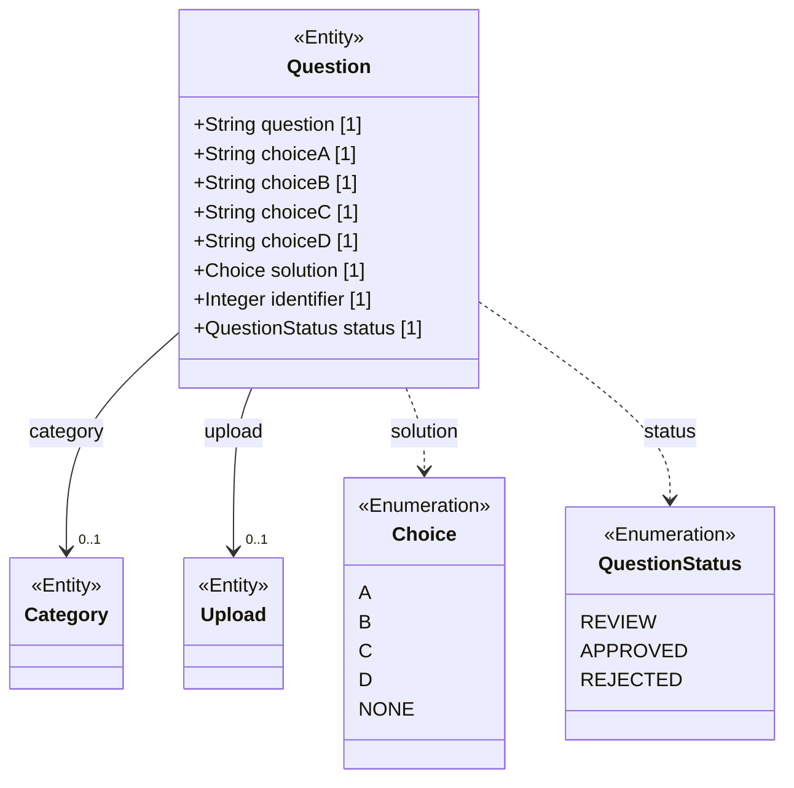

## Model shape

The shape has one non-CRUD question entity, a choice enumeration with the four answer letters and a NONE default, a question status enumeration, and two optional lookups.

- **Question** holds the question text, four choice texts (choiceA to choiceD, required), a required `solution` of type Choice, a required integer `identifier` and a required `status` of type QuestionStatus. Its create, update and delete are off; rows come from backend operations.
- **Choice** is the enumeration of answer letters (A, B, C, D) plus NONE. NONE is the sentinel for an unanswered question.
- **QuestionStatus** is the review state (REVIEW, APPROVED, REJECTED).
- **Category** and **Upload** are optional lookups. A question has at most one of each (0..1, association kind), so deleting a category or upload does not remove the question.

The identifier should be numbered from a database sequence so that numbers stay unique across bulk imports. Use a sequence default expression on the attribute; the platform defaults identifier and number sequences to database sequences. The default is not drawn in the diagram.

Generated UI pages follow from the entity: a View, Form and Table page for Question. With the three flags false the generated UI offers no create button and no editing, because rows are created by the backend. The Table and View pages stay, read-only.

## Structure diagram

