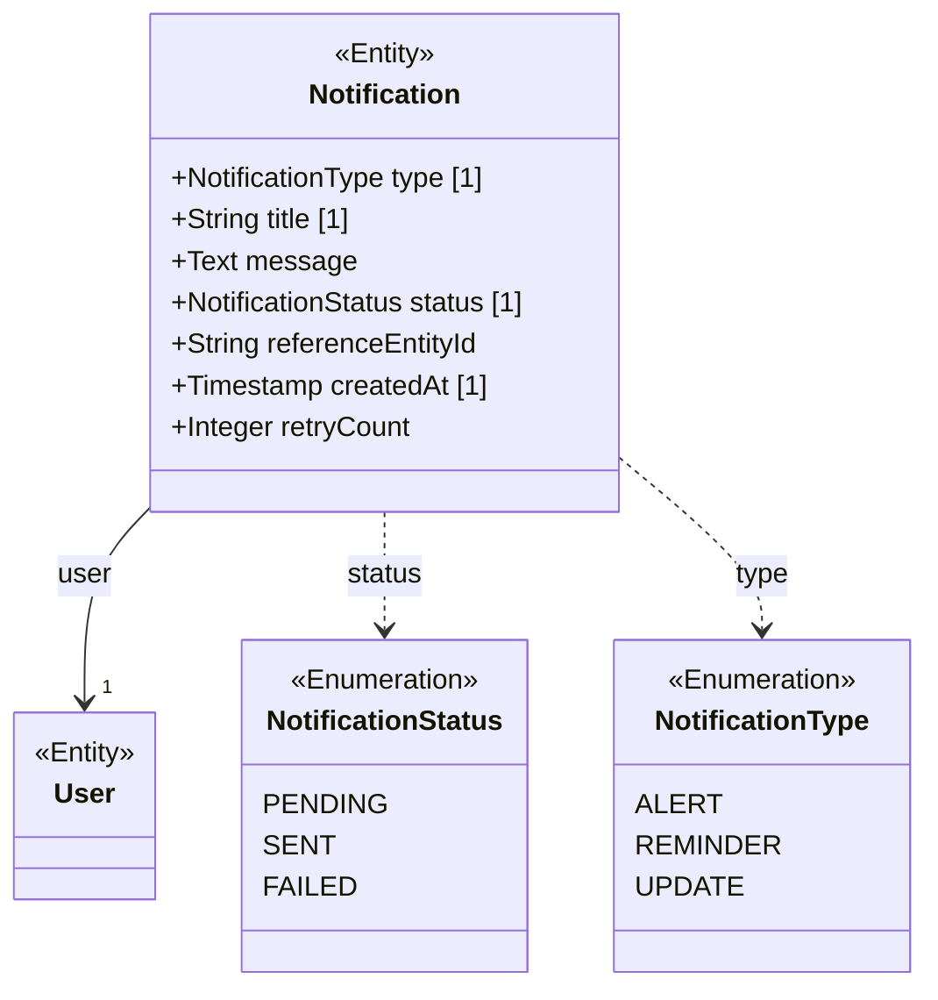

## Model shape

The shape has one non-CRUD notification entity, a type enumeration, a delivery status enumeration and one required user association.

- **Notification** holds the required type, title, created time and status, and optional message, reference id and retry count. Create, update and delete are off; rows come from backend delivery code.
- **NotificationType** lists the kinds of notification (ALERT, REMINDER, UPDATE). The type drives the icon and the link the user follows.
- **NotificationStatus** tracks delivery: PENDING, SENT, FAILED. A retry job picks up FAILED and stuck PENDING rows.
- **User** is the recipient. Each notification has exactly one user (1..1, association kind). Deleting a user is a separate decision; the association does not own the notification.

The reference id points to the content the notification is about. It is a plain string, not a relation, so the notification survives when that content is removed.

Generated UI pages follow from the entity: a View and Table page for Notification, read-only. With the three flags false the generated UI offers no create or edit controls, because the backend creates rows.

## Structure diagram

<!-- mermaid:generated fragment=notification-entity cli=1.1.0.20261108_202643_d9769d90_develop -->

<!-- /mermaid:generated -->
