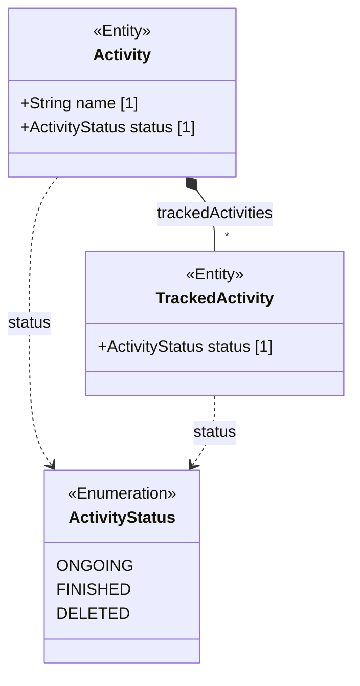

## Model shape

The shape has one enumeration with three members, used as the status attribute of a time-bounded owning entity. Activity is the owner. Its tracked child entities carry the same status.

- **ActivityStatus** is the enumeration. Its members are ONGOING (ordinal 0), FINISHED (ordinal 1) and DELETED (ordinal 2). Values are stored as ordinals.
- **Activity** has a required name identifier and a required status that defaults to ONGOING. It owns its TrackedActivity children through a composition (0..*).
- **TrackedActivity** has a required status of the same enumeration. It is part of the owner's composition, so it is removed with its owner.

The enumeration has no operations and no relations. The transitions are written in the owner's operations or in application services, not in the model.

Pages come from the transfer objects and access points a project defines over these entities, not from the entities. If a transfer object maps the status as a writable attribute, its form lets a user pick any state. If only operations may change status, map it read-only on the transfer object and expose transitions as operations (actions) instead.

## Structure diagram

<!-- mermaid:generated fragment=ongoing-finished-deleted-status-enum cli=1.1.0.20261108_202643_d9769d90_develop -->

<!-- /mermaid:generated -->
