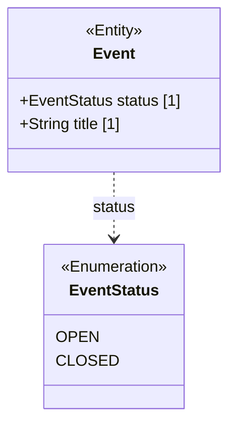

## Model shape

The shape has one non-CRUD entity with a two-state status, an EventStatus enumeration with OPEN and CLOSED, and two instance operations that move the entity between the states.

- **Event** holds a required status (EventStatus) and a required title. Create, update and delete are off; the operations are the only way to change the state.
- **EventStatus** lists OPEN and CLOSED. The status defaults to CLOSED in this shape, so a new entity is not available until it is opened.
- **open** and **close** are instance operations. Each sets the status to its state. Both are declared with `customImplementation` true (stateful, instance operations), so the body lives in Java backend code.

Generated UI pages follow from the entity: a View and Table page for Event. With the three flags false the generated UI offers no create or edit controls, because rows are created by the backend. The open and close actions appear on the View page.

## Structure diagram

