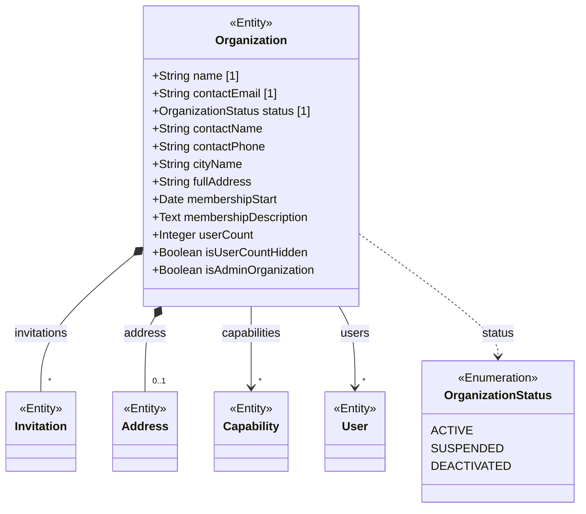

## Model shape

The shape is one Organization entity with a status enumeration and four related entities: Address (composed, 0..1), Capability and User (associations, 0..*) and Invitation (composed, 0..*).

- **Organization** has three required attributes: name, contactEmail and status. Contact name and phone, city name, full address, membership start and description, user count and two flags (isUserCountHidden, isAdminOrganization, both default false) are optional.
- **OrganizationStatus** is an enumeration with ordinals ACTIVE (0), SUSPENDED (1) and DEACTIVATED (2). In the source project only ACTIVE organizations appear in discovery lists (project rule).
- **Address** is composed: it has no life of its own, so it is deleted with the organization.
- **Capability** and **User** are associations: deleting an organization does not delete them.
- **Invitation** is composed: pending invitations are removed with the organization.

Generated UI pages follow from the entity: View, Form and Table pages for Organization. Keep the generated View and Table for administrators. Customize the Form only when the entity needs a custom page (see frontend.md). Status changes go through custom operations (suspend, reactivate), which enforce the allowed transitions (project rules in a project service).

## Structure diagram

