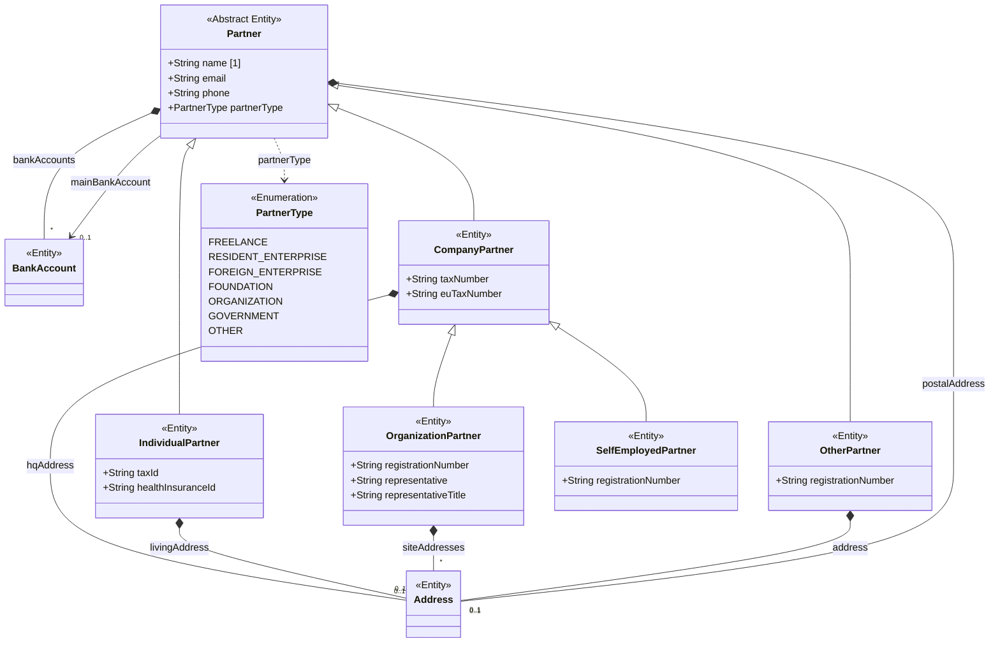

## Model shape

The shape is an abstract Partner base, an abstract intermediate CompanyPartner, four concrete subtypes, a PartnerType enumeration and two owned entities, Address and BankAccount.

- **Partner** is abstract. Attributes: name (required), email, phone, partnerType. Relations: bankAccounts (composition, 0..*), mainBankAccount (association, 0..1) and postalAddress (composition, 0..1).
- **CompanyPartner** extends Partner. It is a concrete intermediate type that groups the company-like forms. Attributes: taxNumber, euTaxNumber. Relation: hqAddress (composition, 0..1).
- **OrganizationPartner** extends CompanyPartner: registrationNumber, representative, representativeTitle and siteAddresses (composition, 0..*).
- **SelfEmployedPartner** extends CompanyPartner: registrationNumber.
- **IndividualPartner** extends Partner directly: taxId, healthInsuranceId and livingAddress (composition, 0..1).
- **OtherPartner** extends Partner directly: registrationNumber and address (composition, 0..1).
- **PartnerType** is an enumeration: FREELANCE, RESIDENT_ENTERPRISE, FOREIGN_ENTERPRISE, FOUNDATION, ORGANIZATION, GOVERNMENT, OTHER.

Composition cascades on delete: removing a partner removes its addresses and bank accounts. The main bank account is an association, so it is a reference only and never deletes an account.

### Transfer objects and generated pages

Transfer objects mirror the hierarchy: each actor sees the subtypes it manages through its own mapped transfer objects, with operations that add or remove the addresses and bank accounts. A partner-select transfer object (name and phone) serves pickers. Only mapped, non-abstract transfer objects get Create. If an access targets the abstract base, the generated Create action offers the concrete subtypes (see the [advanced modeling patterns](../../agent-docs/model/advanced-modeling-patterns.md)). Keep generated View and Table pages per subtype; hide the Form of the abstract Partner.

## Structure diagram

