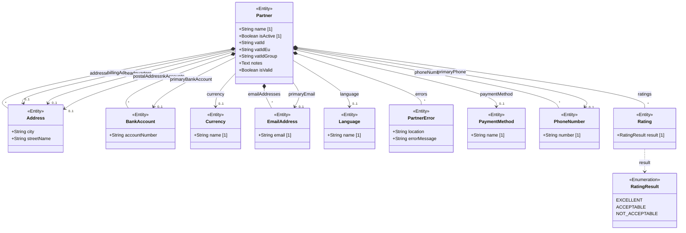

## Model shape

The shape is a Partner entity with six composed collections, nine optional associations and a rating enumeration.

- **Partner** has name (required), isActive (required, default true), vatId, vatIdEu, vatIdGroup, notes and isValid (default true).
- **Composed collections (0..*)**: addresses, bankAccounts, emailAddresses, phoneNumbers, ratings and errors. They are owned by the partner and deleted with it.
- **Preferred contacts (association, 0..1)**: headquarters, billingAddress and postalAddress to an Address; primaryBankAccount; primaryEmail; primaryPhone.
- **Reference data (association, 0..1)**: paymentMethod, currency and language. They outlive the partner.
- **Rating** holds a RatingResult (EXCELLENT, ACCEPTABLE, NOT_ACCEPTABLE).
- **PartnerError** holds a field location and a message, written by the validate operation.

Generated UI pages follow from the entities: View, Form and Table pages for Partner and for each contact. Keep the generated Form for the partner and embed the contact tables; customize it only for the validation display (see frontend.md).

## Structure diagram

<!-- mermaid:generated fragment=partner-with-contact-details cli=1.1.0.20261108_202643_d9769d90_develop -->

<!-- /mermaid:generated -->
