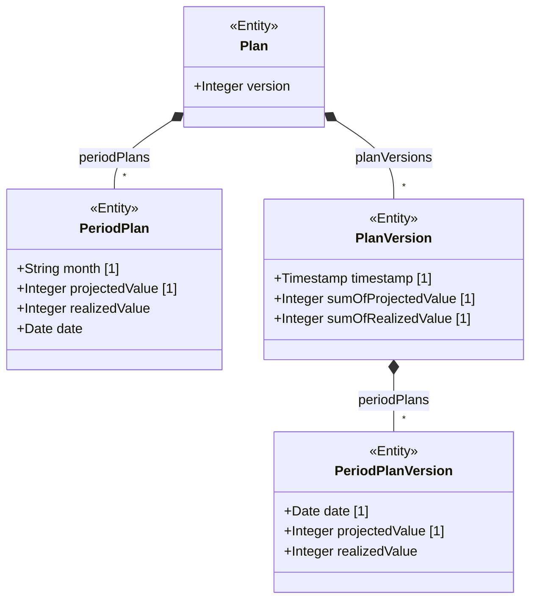

## Model shape

The shape has one parent entity, two kinds of period row and one version entity. Every relation is a composition, so a version and its rows are deleted with the parent, and the period rows of a version are deleted with that version.

- **Plan** is the parent. It has an integer version counter and an instance operation `archiveVersion`. It composes the current period plans (0..*) and the archived versions (0..*).
- **PeriodPlan** is the current row: period (required), projected value (required), realized value and date (optional). It has no relations and no operations.
- **PlanVersion** is the archive: timestamp and the two totals (all required). It composes its period rows (0..*).
- **PeriodPlanVersion** is the frozen copy of a row: date (required), projected value (required), realized value (optional). Nothing edits it after the archive.

The current rows, the version and its rows are not createable, updateable or deleteable through generated actions; the archive operation and the backend write them.

### Archive operation

`archiveVersion` is an instance operation on the parent entity, with a custom implementation (the body is not generated). A transfer object that exposes the parent maps the operation as a mapped operation, so a user can call it from the generated page. Because the operation is custom, no interceptor runs for it: it does its own copying inside its transaction.

### Transfer objects

The user-facing transfer objects mirror the entities: the parent exposes the current rows and the versions as aggregations (embedded lists of mapped transfer objects), and each version exposes its period rows the same way. A parent relation's updateable and deleteable flags decide which actions the generated page offers on the navigated child. Keep the version rows view-only.

## Structure diagram

