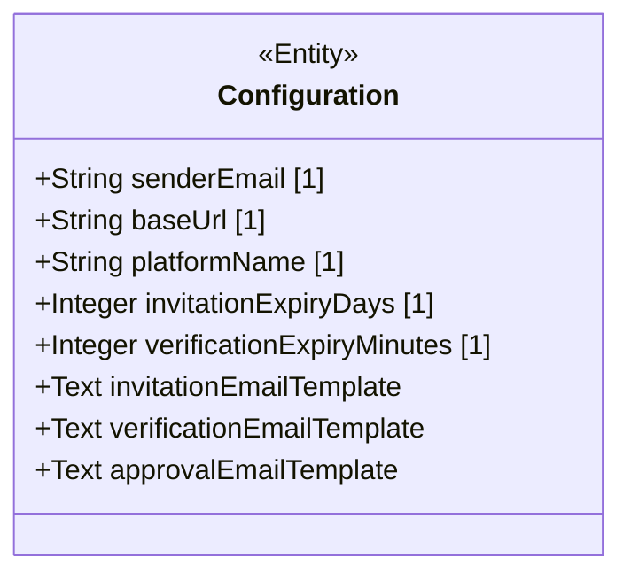

## Model shape

The shape has one Configuration entity. It is not createable and not deleteable. It is updateable when settings are changed through the generated update.

- **Configuration** holds the platform settings as plain attributes. Typical attributes are the sender address and base URL (text, required), the platform name (text, required), expiry durations (integers, required), and email templates (long text, optional).
- The variants add other attributes to the same entity: numeric business parameters with defaults, closing times, and document templates stored as binary data. A variant may also add a composition to a sub-entity such as per-currency thresholds.
- A transfer object maps onto Configuration for reads. A separate input transfer object has all fields optional, so a partial update sends only the fields it changes. The input transfer object is not mapped to the entity.
- Access: an administrator actor reads and updates the configuration. Other actors do not see the entity.

Generated UI pages follow from the entity. Keep the View and Update pages for administrators. The createable and deleteable flags are false, so the generated UI shows no Create or Delete action for the entity. The update form should be pre-filled with current values; see [frontend.md](frontend.md).

## Structure diagram

