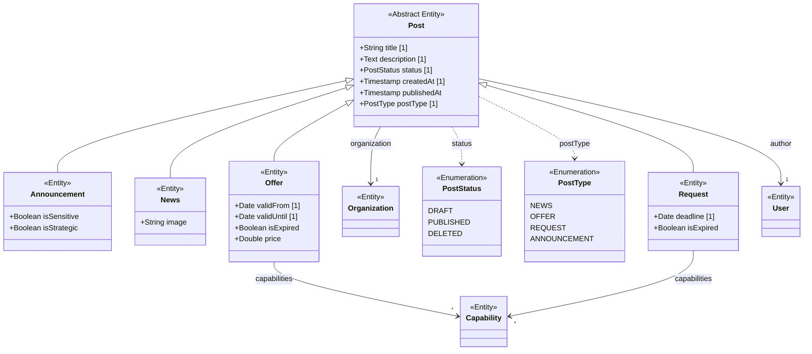

## Model shape

The shape has one abstract base, Post, with four concrete subtypes, and two enumerations. The base holds what every kind of content shares.

- **Post** is abstract. It has title (required), description (required), status (required, PostStatus enumeration), createdAt (required), publishedAt (optional) and postType (required, PostType enumeration). It has a required association to User (author) and a required association to Organization. It has a composition to Inquiry (zero or more).
- **News** extends Post and adds an optional image.
- **Offer** extends Post and adds validFrom and validUntil (both required dates), an optional price and an expired flag. It has zero or more associations to Capability.
- **Request** extends Post and adds a required deadline and an expired flag. It has zero or more associations to Capability.
- **Announcement** extends Post and adds two optional flags, sensitive and strategic. It has zero or more associations to documents.
- **PostStatus** is an enumeration of DRAFT, PUBLISHED and DELETED. Each value is stored as an ordinal.
- **PostType** is an enumeration of NEWS, OFFER, REQUEST and ANNOUNCEMENT, one per subtype.

Generated UI pages follow from the entities. Keep the View, Form and Table pages for each subtype. Hide the generated Form for Post itself, because it is abstract. Subtypes may replace their generated View with a custom view; see [frontend.md](frontend.md).

## Structure diagram

<!-- mermaid:generated fragment=post-generalization-hierarchy cli=1.1.0.20261108_202643_d9769d90_develop -->

<!-- /mermaid:generated -->
