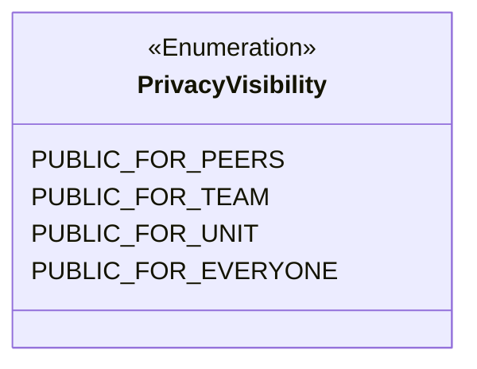

## Model shape

The shape is one enumeration, `PrivacyVisibility`, with four members: PUBLIC_FOR_PEERS (ordinal 1), PUBLIC_FOR_TEAM (ordinal 2), PUBLIC_FOR_UNIT (ordinal 3) and PUBLIC_FOR_EVERYONE (ordinal 4). Members persist by ordinal, so the order is never changed.

A settings entity (for example `UserPrivacySettings`) carries one attribute per privacy-controlled field, each typed to `PrivacyVisibility`. The user entity holds the settings through an optional composition (0..1), so the settings are owned by the user and removed with it. The settings entity is not part of the generated diagram.

## Structure diagram

<!-- mermaid:generated fragment=privacy-visibility-enum cli=1.1.0.20261108_202643_d9769d90_develop -->

<!-- /mermaid:generated -->
