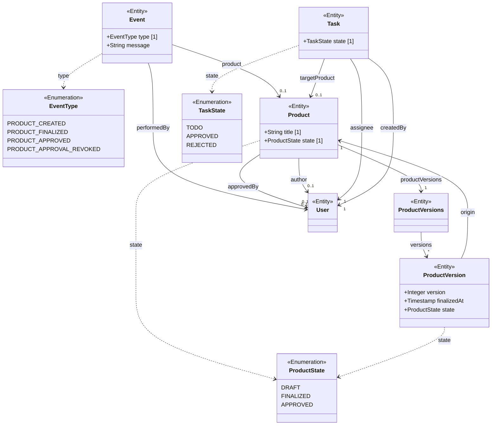

## Model shape

The shape has one main entity, Product, with a state enumeration, a version history, tasks and an event log. Only the workflow core is drawn.

- **Product** has a required title and a required state (ProductState). It has an optional author and approvedBy association to User, a required association to ProductVersions, and custom instance operations finalize, assignApproval, approveVersion, revokeApproval and draftNewVersion.
- **ProductState** is an enumeration: DRAFT, FINALIZED, APPROVED. Values are stored as ordinals.
- **ProductVersion** has a version number, a finalized timestamp and a state snapshot, and a required association origin to Product.
- **ProductVersions** is the container with zero or more ProductVersion.
- **Task** has a TaskState (TODO, APPROVED, REJECTED), a required assignee and createdBy association to User, and an optional targetProduct.
- **Event** has an EventType (PRODUCT_CREATED, PRODUCT_FINALIZED, PRODUCT_APPROVED, PRODUCT_APPROVAL_REVOKED), a message, and optional associations to Product and User (performedBy).
- **Role transfer objects** (admin, author, approver, guest product views) expose the content and the operations each role may call, with boolean guard attributes that control visibility. They are not part of the diagram.

Generated UI pages follow from the entities; the product lists are replaced by custom card views, see [frontend.md](frontend.md).

## Structure diagram

