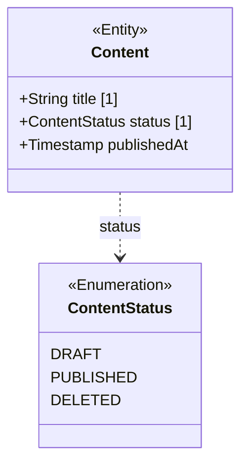

## Model shape

The shape is one content entity, `Content`, with a required title, a required status of enumeration type `ContentStatus` (DRAFT ordinal 0, PUBLISHED ordinal 1, DELETED ordinal 2) and an optional published-at timestamp.

The content's transfer object `ContentTO` maps to the entity and declares three instance operations, all custom: `publish`, `delete` and `editContent` (the real project names the edit operation after the content type, for example `editNews`). It also exposes derived guard flags such as `isNotPublishable` and `isNotDeletable`, which the UI uses to show or hide the buttons. The guard flags are computed from the status and carry no business rule of their own.

## Structure diagram

<!-- mermaid:generated fragment=publish-delete-edit-operations cli=1.1.0.20261108_202643_d9769d90_develop -->

<!-- /mermaid:generated -->
