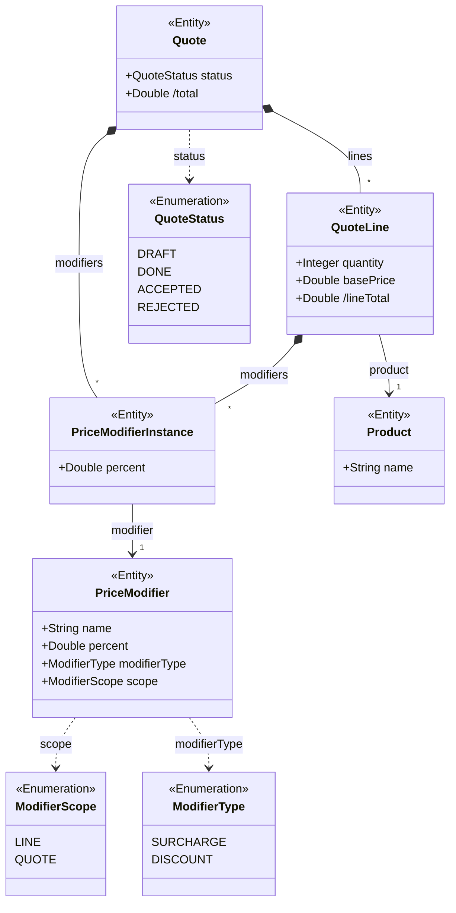

## Model shape

Quote is the root entity. It has a stored `status` of the QuoteStatus enumeration (draft, done, accepted, rejected), a composition `lines` to QuoteLine, a composition `modifiers` to PriceModifierInstance and a derived numeric `total` that sums the line totals. QuoteLine has an integer `quantity`, a numeric `basePrice`, a mandatory association `product` to Product and a derived `lineTotal`. Each line also composes its own `modifiers`. PriceModifier is the definition with `name`, `percent`, `modifierType` (ModifierType: surcharge, discount) and `scope` (ModifierScope: line, quote). PriceModifierInstance has a `percent` and a mandatory association `modifier` to the definition.

### Pages the shape implies

Generated pages give a quote table and view with the lines and modifiers as nested tables. Keep the generated forms for line and modifier creation. Offer the modifier definition as a lookup when a user adds an instance. Show `total` and `lineTotal` as read-only.

### Access

Make the quote the access root. Product and PriceModifier are reference data and need read access for everyone who edits quotes.

## Structure diagram

