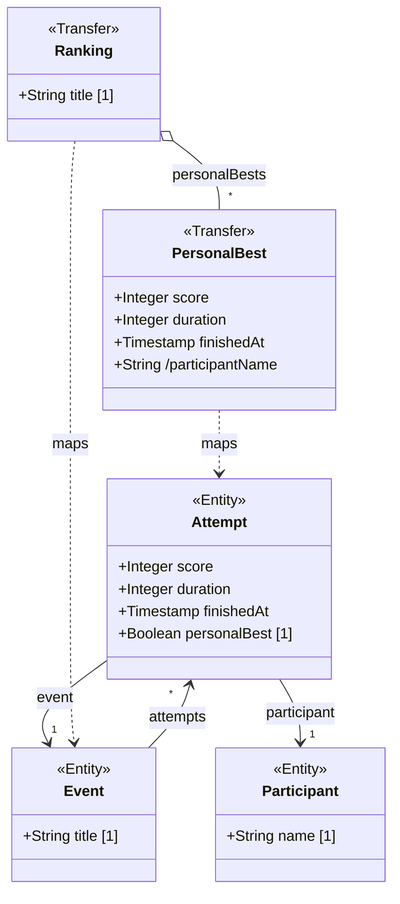

## Model shape

Three entities and two transfer objects.

- `Event`: required `title`; association `attempts` (0..*) to `Attempt`.
- `Participant`: required `name`.
- `Attempt`: `score`, `duration`, `finishedAt`, and required boolean `personalBest` (default false); associations `event` (1..1) and `participant` (1..1).
- `PersonalBest` (transfer object, mapped to `Attempt`): mapped `score`, `duration`, `finishedAt`; derived `participantName` (`self.participant.name`).
- `Ranking` (transfer object, mapped to `Event`): mapped `title`; derived aggregation `personalBests` (0..*) to `PersonalBest`, defined by filtering the event's attempts on `personalBest`.

The `personalBest` flag is an entity attribute, so it is available to the filter but is deliberately not exposed on the row transfer object in this example (display only).

### Access

Not drawn. The participant actor reaches the event through its own view, which has a `ranking` relation (0..1) and a `personalBests` relation (0..*) for the participant's own bests. All of it is read-only. See [dashboard-transfer-object](../dashboard-transfer-object/BLUEPRINT.md) for the same read-model idea.

### Generated UI pages

The generated ranking view and its table of rows are enough for a plain list. The source project replaces them with a custom dialog; see the frontend guidance.

## Structure diagram

