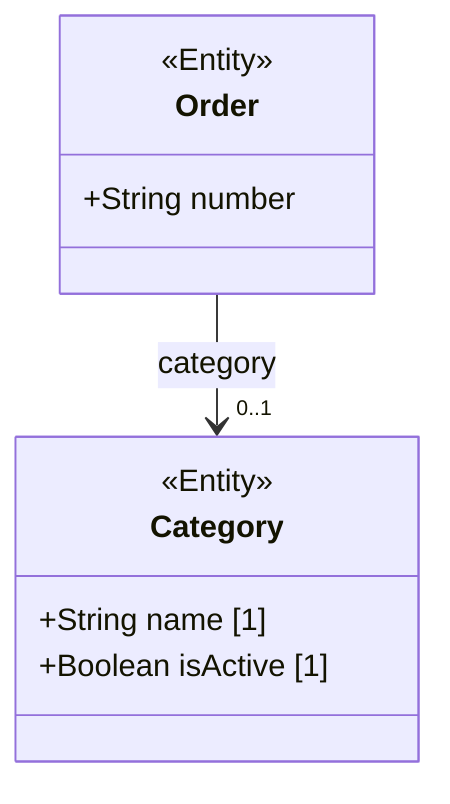

## Model shape

The shape is a lookup entity, `Category`, and a referencing entity, `Order`.

- `Category` has a required `name` (the identifier) and a required boolean `isActive` that defaults to true. Its createable, updateable and deleteable flags are all false.
- `Order` holds a one-way association `category` to `Category` with cardinality 0..1. Use 1..1 when a choice is mandatory and 0..* for a multi-select.

The flag and its name are optional and differ by project (`active`, `isActive`, `isEnabled`). The simplest variants have only the name.

### Generated UI pages

Because the entity flags are off, the generated pages for the lookup are read-only. Whether an administrator edits the list depends on the access and transfer object the project gives that actor. In the source projects the administrator gets a mapped transfer object with the name and the flag. Other actors get a name-only transfer object. The referencing form shows the association as a single selector, or as a multi-select table when the cardinality is 0..*.

### Seeding

Lookup rows are normally created by a seeding step at startup, or by administrator operations. In the source projects the seeding step is a static initializer operation (see [[initializer-entity-with-init-operation]]). Where the lookup is managed by an actor, the access point on the transfer object carries create and update rights; the entity flags stay false.

## Structure diagram

