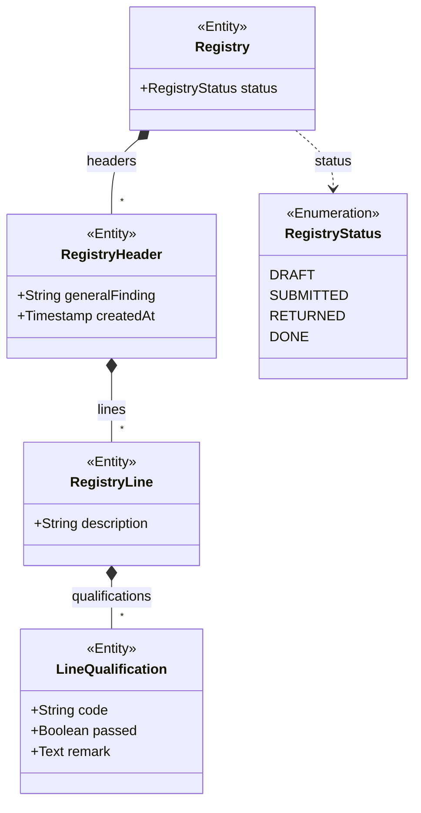

## Model shape

Registry is the root entity. It has a stored `status` of the RegistryStatus enumeration (draft, submitted, returned, done) and a composition `headers` to many RegistryHeader. RegistryHeader has a text `generalFinding`, a `createdAt` timestamp and a composition `lines` to many RegistryLine. RegistryLine has a text `description` and a composition `qualifications` to many LineQualification. LineQualification has a string `code`, a boolean `passed` and a text `remark`. All three relations are one-way compositions with cardinality 0..*.

### Pages the shape implies

Generated pages give a registry table and view. The header and line collections show as tables inside the registry view. Keep the generated forms for header and line creation. Hide the standalone tables for LineQualification, since a qualification only makes sense inside its line.

### Access

Make the registry the access root. Headers, lines and qualifications are reached through it, so they need no access of their own.

## Structure diagram

<!-- mermaid:generated fragment=registry-header-with-lines cli=1.1.0.20261108_202643_d9769d90_develop -->

<!-- /mermaid:generated -->
