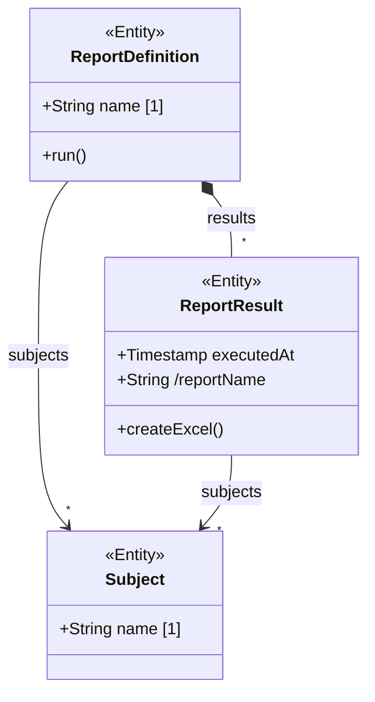

## Model shape

Three entities and two instance operations.

- `ReportDefinition`: required `name`; association `subjects` (0..*) to `Subject`; composition `results` (0..*) to `ReportResult`; instance operation `run` (stateful, custom implementation).
- `ReportResult`: timestamp `executedAt`; binary `file` (the export; not drawn in the diagram because the sandbox has no binary type); association `subjects` (0..*) to `Subject`; derived `reportName`, defined by navigating to the container `ReportDefinition` and reading its name; instance operation `createExcel` (stateful, custom implementation).
- `Subject`: the reported entity, for example a user or unit. It stands for any domain entity the report covers.

### Transfer objects and access

Not part of the diagram. In the source project the report package holds these transfer objects:

- a definition view: `name` mapped, `results` as an association to a result view, subjects as aggregations, and `run` as a mapped operation;
- a result view: timestamp and report name, and the file;
- a helper view for the export, with `createExcel` as a mapped operation;
- row views that flatten the subjects, with mapped, derived and transient attributes. The all-transient row view is the flat structure used to write the export.

The actor reaches the definition view through an access point; the results come with it.

### Generated UI pages

The definition view page lists its results in a table and shows the `run` action as a button. The result page shows the timestamp and a download link for the file. Keep these generated pages; add a button for `createExcel` only if the export is a separate step.

## Structure diagram

