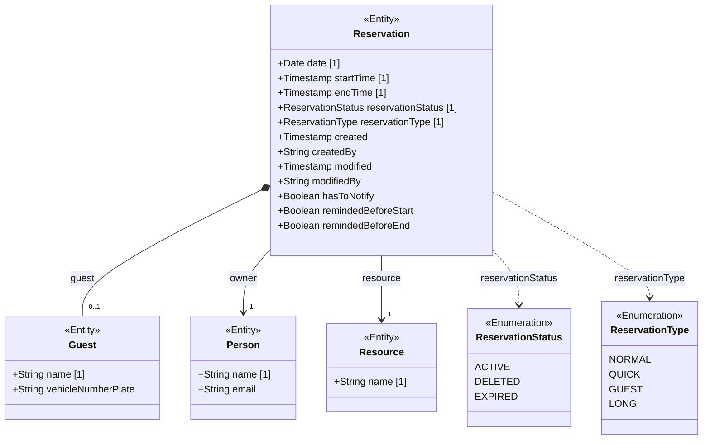

## Model shape

Four entities and two enumerations.

- `ReservationStatus`: ACTIVE (1), DELETED (2), EXPIRED (3). `ReservationType`: NORMAL (1), QUICK (2), GUEST (3), LONG (4). Ordinals persist; never renumber.
- `Reservation`: required `date`, `startTime`, `endTime`, `reservationStatus`, `reservationType`; optional `created`, `createdBy`, `modified`, `modifiedBy`, `hasToNotify`, `remindedBeforeStart`, `remindedBeforeEnd`. Association `owner` to `Person` (1..1), association `resource` to `Resource` (1..1), composition `guest` to `Guest` (0..1).
- `Person` is the owning user entity and `Resource` the reserved thing; both stand for domain entities.
- `Guest`: required `name`, optional `vehicleNumberPlate`. It lives only inside its reservation.

### Transfer objects and access

Not drawn. The entity flags are off. The actor sees reservations through transfer objects:

- a list view of the user's active reservations and one of previous reservations, each with read-only guard attributes (not deletable, not cancelable) that the page uses to hide buttons;
- an input transfer object for create, with the owner, resource, type, date and times, and the guest fields. A reference range on its resource relation limits the choices to accessible and free slots (see [interceptors](../../agent-docs/backend/interceptors.md));
- a modification input with the new times;
- mapped operations on the list view for cancel, delete and modify.

### Generated UI pages

Keep the generated create dialog (driven by the input transfer object) and the list tables. In the source project the tables are replaced by card views, see [[cards-container-configuration-hook]].

## Structure diagram

<!-- mermaid:generated fragment=reservation-booking-entity cli=1.1.0.20261108_202643_d9769d90_develop -->

<!-- /mermaid:generated -->
