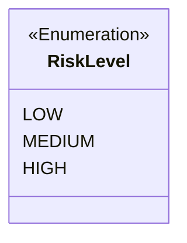

## Model shape

The shape is one enumeration, `RiskLevel`, with three members: LOW (ordinal 1), MEDIUM (ordinal 2) and HIGH (ordinal 3). Ordinals are the persisted form, so they are never renumbered.

An entity (in the source project, an initiative) carries an attribute `riskLevel` of type `RiskLevel`, set explicitly with no default. The entity is not part of this shape. In the source project the same entity also exposes the attribute on its transfer object, so it appears in the view and in the edit form as a choice among the three members.

## Structure diagram

<!-- mermaid:generated fragment=risk-level-enum cli=1.1.0.20261108_202643_d9769d90_develop -->

<!-- /mermaid:generated -->
