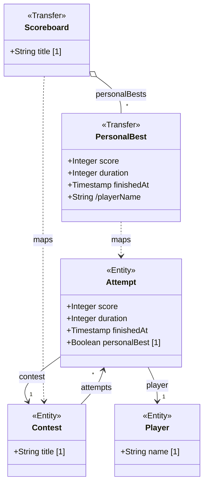

## Model shape

Three entities and two transfer objects.

- `Contest`: required `title`; association `attempts` (0..*) to `Attempt`.
- `Player`: required `name`.
- `Attempt`: `score`, `duration`, `finishedAt`, and required boolean `personalBest` (default false); associations `contest` (1..1) and `player` (1..1).
- `PersonalBest` (transfer object, mapped to `Attempt`): mapped `score`, `duration`, `finishedAt`; derived `playerName` (`self.player.name`).
- `Scoreboard` (transfer object, mapped to `Contest`): mapped `title`; derived aggregation `personalBests` (0..*) to `PersonalBest`, defined by filtering the contest's attempts on `personalBest`.

The `personalBest` flag is an entity attribute, so it is available to the filter but is deliberately not exposed on the row transfer object in this example (display only).

### Access

Not drawn. The player actor reaches the contest through its own view, which has a `scoreboard` relation (0..1) and a `personalBests` relation (0..*) for the player's own bests. All of it is read-only. See [dashboard-transfer-object](../dashboard-transfer-object/BLUEPRINT.md) for the same read-model idea.

### Generated UI pages

The generated scoreboard view and its table of rows are enough for a plain list. The source project replaces them with a custom dialog; see the frontend guidance.

## Structure diagram

<!-- mermaid:generated fragment=scoreboard-personal-best-pattern cli=1.1.0.20261108_202643_d9769d90_develop -->

<!-- /mermaid:generated -->
